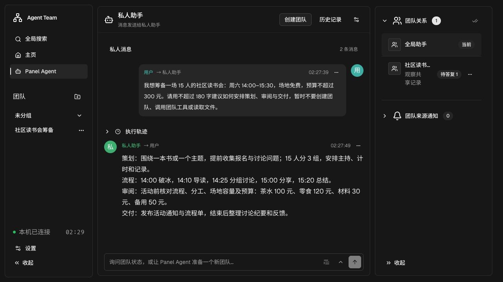
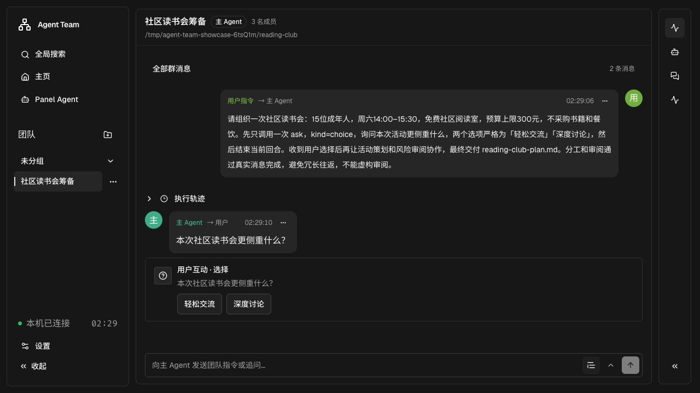
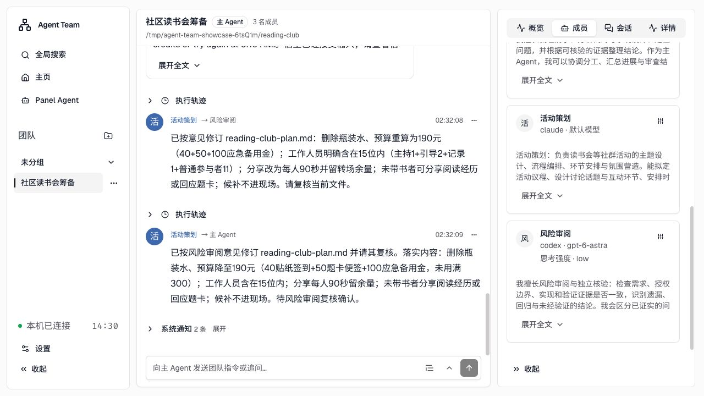
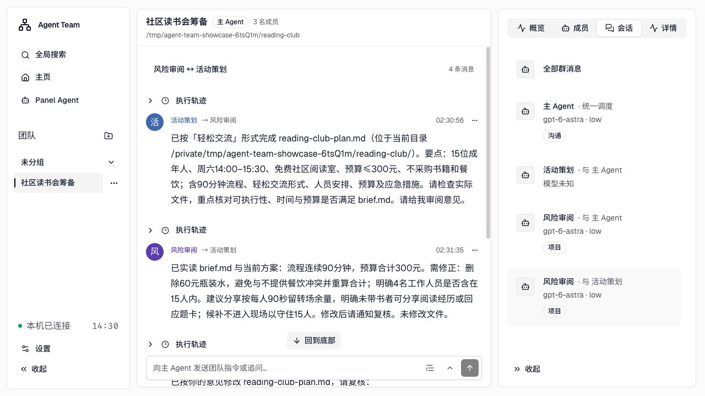
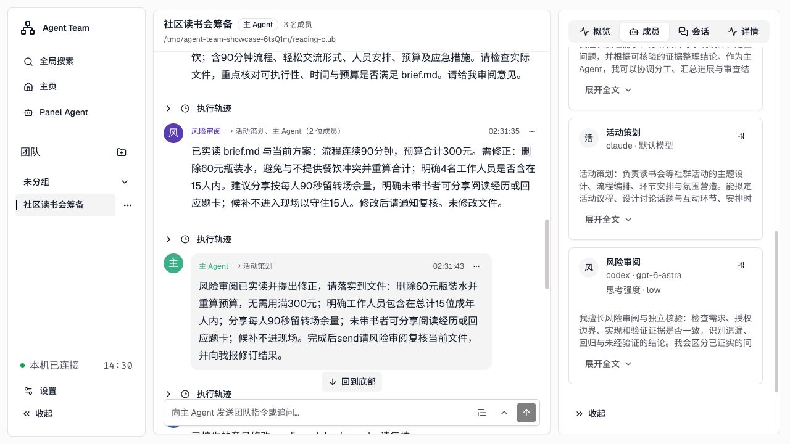
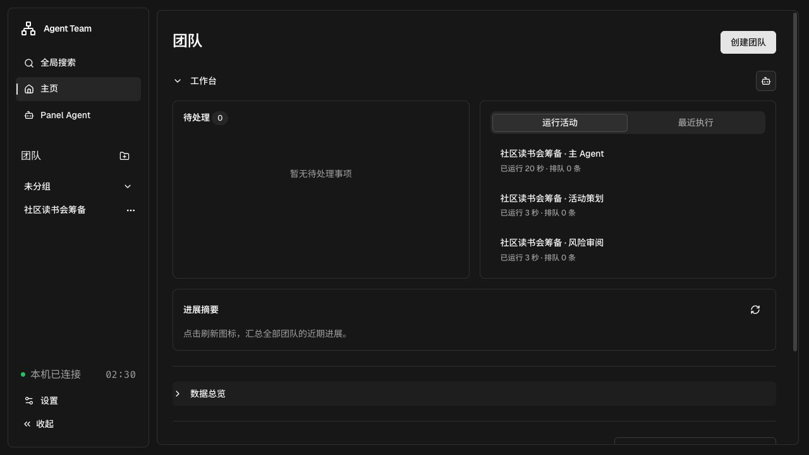
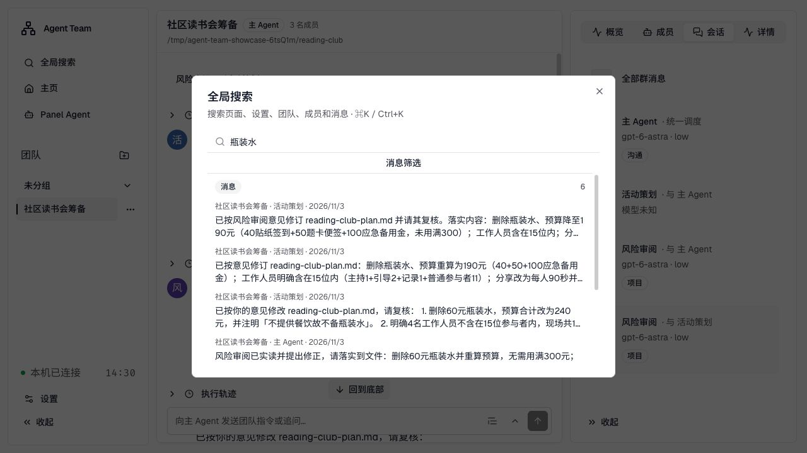
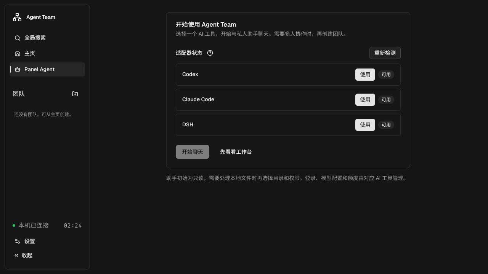
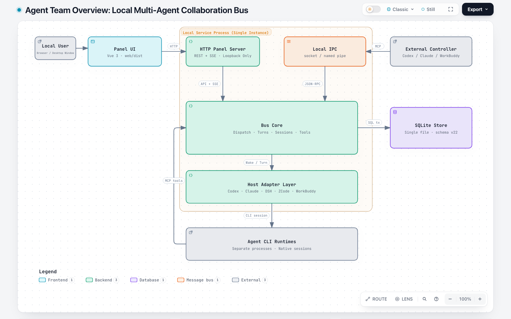

# Agent Team

[简体中文](README.md) · English

**Organize multiple local AI assistants to discuss, divide, and complete work together.**

Hand a request to a Main Agent and let different assistants handle planning, execution, and review. Collaborate from a desktop window, a browser, or directly from an already-connected CLI agent via MCP—keeping your work in your own project folder.

[Download v0.5.1](https://github.com/AlbertZhou1108/agent-team/releases/tag/v0.5.1) · [Quick Start](guide/en/quick-start.md) · [User Guide](guide/en/user-guide.md) · [Limitations](guide/en/limitations.md)

The project is gradually converging from the browser UI to a native desktop window: during development you can launch the standalone window with `npm run desktop` (see [Development & Build](guide/en/development.md)); current downloadable release packages still open in the browser.

*Conceptual illustration expressing the collaboration model; real product screenshots appear below.*

## Start from a Single Request

You do not need to learn message buses, CLI flags, or adapters upfront. Open Agent Team, choose an available AI tool, and start chatting with your private assistant (Panel Agent). When a task calls for multiple roles, create a team.

Current source supports **Codex, Claude Code, DSH, and ZCode** as spawnable team members; **WorkBuddy** can connect as an External controller via MCP without being launched as a member. You can stick to one tool or mix different tools inside the same team.

*Private assistant (Chinese UI screenshot): discuss what you want first, then decide how to organize the work.*

## Delegate to a Team, Keep the Final Call

For example, when planning a community reading club: the Main Agent coordinates, a planner drafts the proposal, and a risk reviewer checks timing, headcount, and budget. Members communicate directly, and you can inspect the division of work and feedback in the team feed.

Whenever a decision needs your input, an assistant can send an interaction card. Pick an option or reply so the discussion continues.

*Live interaction card (Chinese UI): should this event lean toward "casual exchange" or "deep discussion"? Interaction cards only consult the user; actual execution permissions are enforced by team policy and the host sandbox.*

## See the Discussion, and See the Issues

On the team page, you can read the full team feed or zoom into a pair conversation between two members. Every member's role and underlying host tool are visible so you know who owns what.

*The planner uses Claude and the risk reviewer uses Codex; member self-profiles explain responsibilities, not capability guarantees.*

*Focus on a single pair conversation to trace review requests and feedback without digging through the entire feed.*

## A Real Collaboration Walkthrough

*Conceptual illustration: submit a brief, review collaboratively, assemble a plan.*

The screenshots on this page come from a fictional community reading club run on live hosts: 15 adults, 90 minutes, a free reading room, a 300 RMB budget cap, and no book purchases or catering.

The reviewer actually read both the brief and the draft, caught **60 RMB for bottled water** still listed in the first draft, and flagged ambiguity around whether staff counted toward the 15-person cap. The planner then revised the file to clarify headcount rules, sharing time slots, and participation for attendees without books.

This walkthrough also hit real-world limits: hosts returned model capacity and quota errors, so the follow-up review after the revision did not finish, and the budget reported in the planner's message differed from the amount in the file. What is shown here is **collaboration, issue discovery, and revision in progress**—not a verified final deliverable. Always inspect actual files and review evidence.

[View the snapshot of the generated plan](guide/en/examples/reading-club-plan.md) · [Learn about failure & recovery](guide/en/limitations.md#sessions-failures-and-recovery)

## Come Back Anytime and Pick Up Where You Left Off

The workbench brings together teams, running activity, and pending items so you can spot what needs attention. Closing the browser tab leaves the local service running; reopen it anytime to continue reading the history.

*The workbench provides a unified entry point; runtime status and usage stats are observational, not proof of correctness.*

As discussions grow, use global search to jump across teams, members, settings, or past messages, and save reusable prompts as snippets.

*Search actual messages to trace the origin of a decision or revision.*

## Getting Started

1. **Prepare an AI tool**: Install and configure at least one of Codex, Claude Code, DSH, or ZCode; login and usage quotas are managed by that tool. WorkBuddy can attach as an External controller, not as a spawned member.
2. **Choose an entry point**: Download a release package from [Releases](https://github.com/AlbertZhou1108/agent-team/releases) and open the panel, or run `agent-team connect` from source to plug Agent Team MCP into an existing host for headless collaboration.
3. **Select an available tool and start chatting**: Connection probes only verify protocol reachability without sending model prompts. When you need collaboration, create a team and choose its workspace folder and access policy.

**v0.5.0 provides release packages for macOS Apple Silicon (arm64), Windows x64, and Linux x64**, each with a SHA-256 checksum and a bundled runtime—no separate Node install or frontend build required. Packages are unsigned and unnotarized, so OS security prompts must be approved manually. v0.5.0 upgrades the data-directory schema to v18; stop running services before upgrading. See [Quick Start](guide/en/quick-start.md) for backup and upgrade steps.

**Release boundary**: The v0.5.0 release packages predate the ZCode member adapter and WorkBuddy controller registration in current source. Run from source to use those hosts, or wait for a newer release build.

## Where It Fits Best

| Goal | How to Organize |
| --- | --- |
| Event, content, or project plans | One member drafts while another checks constraints and gaps |
| Research & comparison | Split topics across members, then let the Main Agent synthesize disagreements and sources |
| Code implementation & review | Assign implementation, testing, and review roles with an explicit workspace and policy |
| Everyday Q&A | Chat with the private assistant first, then spin up a team if needed |

Agent Team is a **local, single-user multi-agent collaboration control plane**: the local service stores framework records while hosts execute model turns; the panel and external MCP are parallel entry points. Model requests may reach external providers and consume your host account's quota. It is neither fully offline nor a multi-user account system.

Choose access scopes carefully, verify actual artifacts, and stop the service when done. The framework does not configure host accounts, and an "available" status does not guarantee the next model call will succeed. [Full limitations & security notes ->](guide/en/limitations.md)

## Architecture & Design Principles

Agent Team runs as a **single-process local service + single-file SQLite + independent host CLI subprocesses**, without hosting model inference or pulling host runtimes into the service process memory:

<picture>
  <source media="(prefers-color-scheme: dark)" srcset="assets/architecture/en/overview-dark.png">
  
</picture>

- **Three entry points sharing one local service**: The browser and Electron desktop window share the same `web/dist` frontend (the desktop shell only handles windowing, tray, and single-instance); external controllers attach via a fixed stdio MCP shim over a local socket or named pipe. HTTP binds strictly to `127.0.0.1` with Host, Origin, cross-site, and CSP checks.
- **Scoped sessions & delivery safety**: One Main Agent coordinates each team serially, while peer members collaborate in isolated pair conversations that run in parallel. `send` persists and wakes immediately; `note` batches onto the next formal message. An unconfirmed runtime is marked `unknown` and blocks further delivery until manually verified—never auto-replayed.
- **Unified host contract & policy boundaries**: Codex, Claude Code, DSH, and ZCode run as separate CLI subprocesses reading and writing the workspace under the active execution policy; turns fail explicitly instead of silently downgrading unsupported policies. WorkBuddy connects strictly as an External controller.
- **Core aggregates & pure-web UI**: Local SQLite (schema v22) relies on 8 aggregate modules under `src/aggregates/` to guard core invariants and nested transactions. The frontend stays pure web—communicating via REST, dual SSE streams (`useEventStream` with ordered frame batching), and 4-tier polling, with optional preload injection and HTTP fallbacks for desktop helpers.

See [Architecture & Communication](guide/en/architecture.md) and [Host Configuration & Adapters](guide/en/host-adapters.md) for the startup/single-instance model, dispatch pipeline, aggregate boundaries, frontend structure, and per-host adapter details.

## Learn More

| Document | Topic |
| --- | --- |
| [Quick Start](guide/en/quick-start.md) | Installation, first chat, creating teams, stopping, and upgrading |
| [User Guide](guide/en/user-guide.md) | Messages, interaction cards, files, workbench, search, and archiving |
| [Limitations & Security](guide/en/limitations.md) | Quotas, permissions, failure recovery, and current boundaries |
| [Architecture](guide/en/architecture.md) | Overview, startup & single-instance, dispatch pipeline, aggregates, and web UI |
| [CLI Reference](guide/en/cli.md) | Terminal entry points, creating teams, and standalone daemon |
| [Host Adapters](guide/en/host-adapters.md) | Host configuration, probes, and writing new adapters |
| [Headless Control Plane](guide/en/headless-control-plane.md) | External controllers, MCP, capability boundaries, and headless workflows |
| [Development & Build](guide/en/development.md) | Running from source, tests, builds, and release packaging |
| [Image Credits](assets/readme/README.md) | Real screenshot notes and concept illustration prompts (ZH) |
