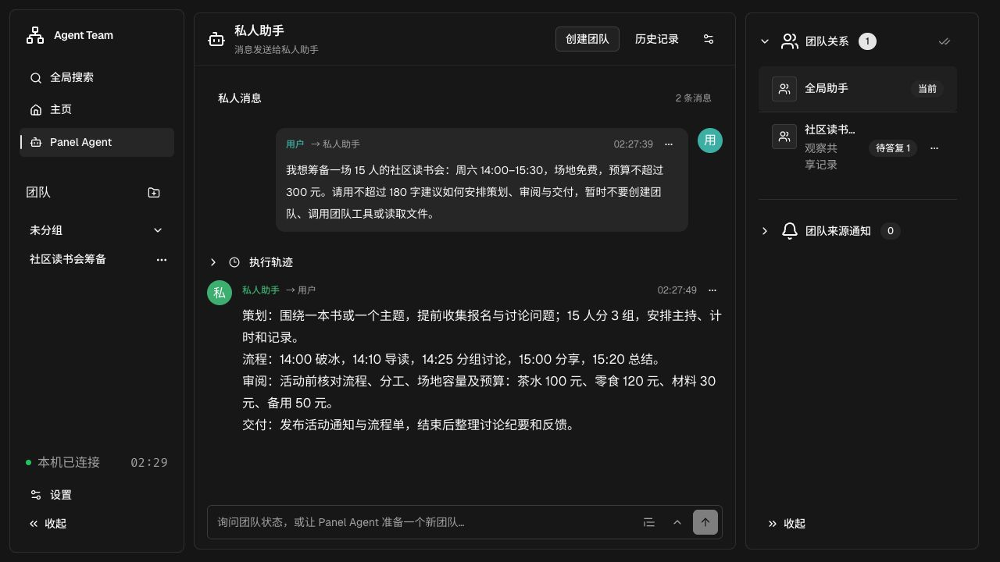
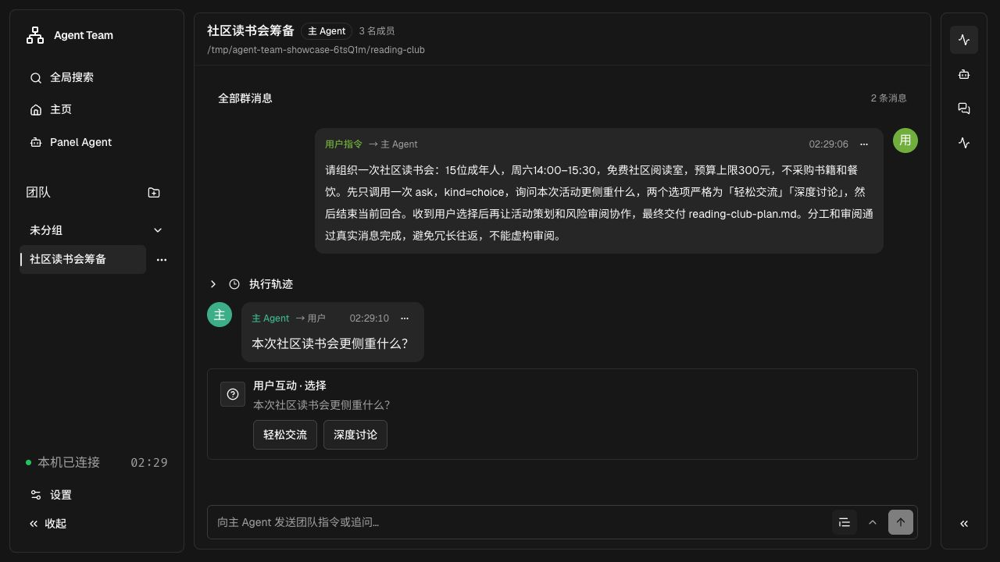
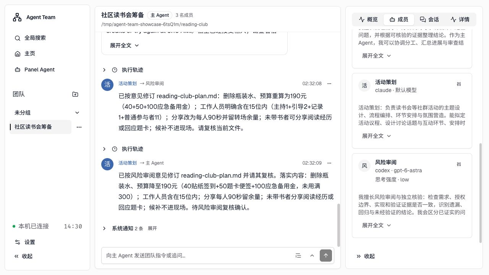
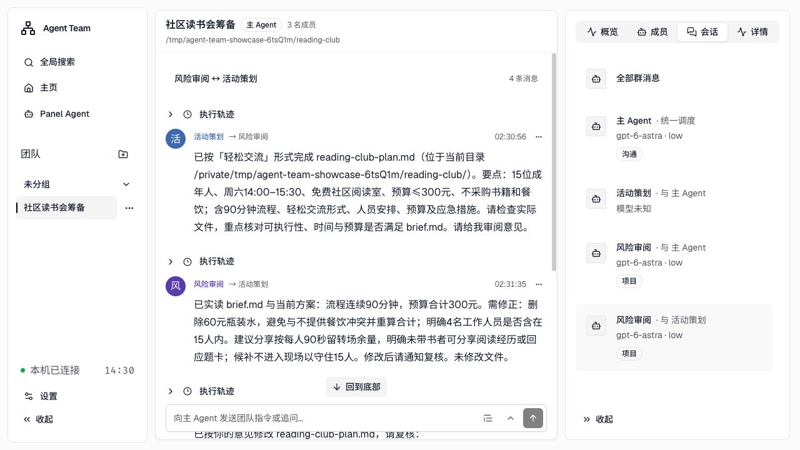
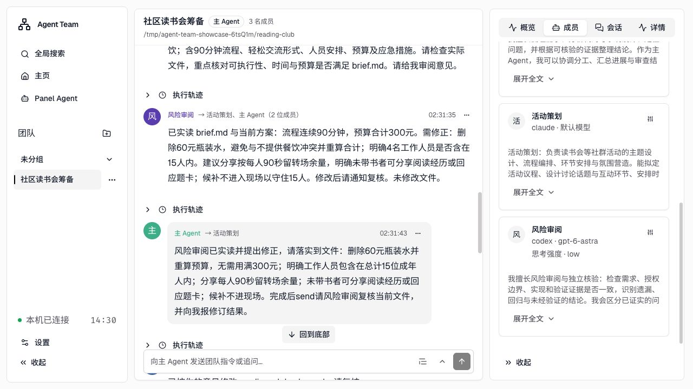
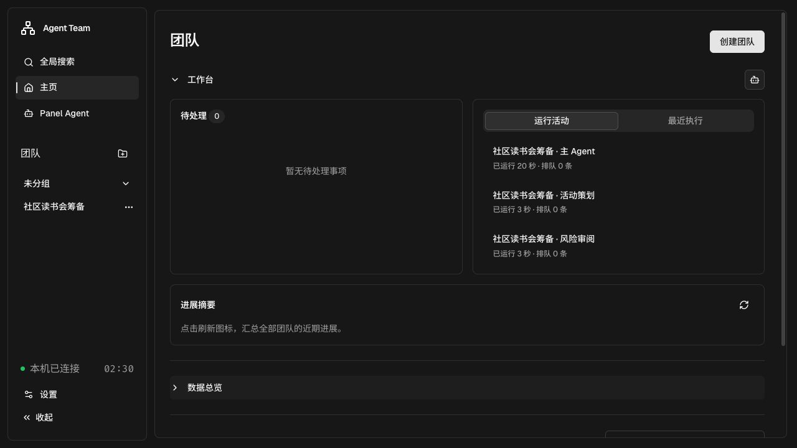
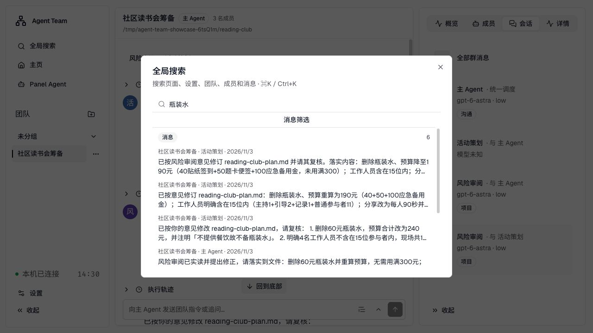
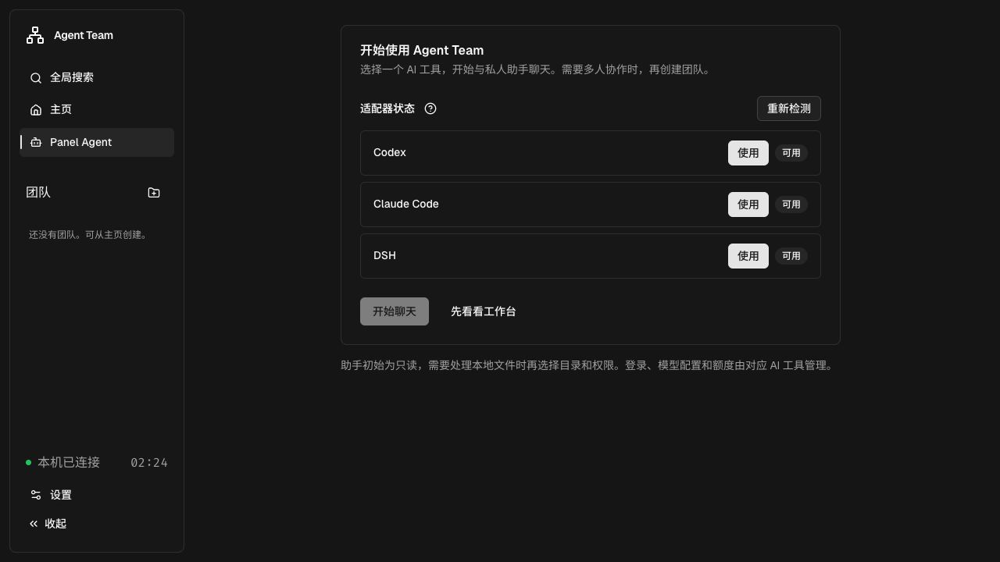

# Agent Team

**在本机组织多个 AI 助手，一起讨论、分工和完成工作。**

把需求交给主 Agent，让不同助手负责策划、执行和审阅。在浏览器里看进展、回答问题、查找讨论，把工作留在自己的工作文件夹中。

[下载 v0.2.0](https://github.com/AlbertZhou1108/agent-team/releases/tag/v0.2.0) · [开始使用](guide/quick-start.md) · [使用指南](guide/user-guide.md) · [能力边界](guide/limitations.md)

*概念插画，用于表达协作方式；软件实机界面见下方。*

## 从一个需求开始

你不必先了解消息总线、命令行参数或适配器。打开 Agent Team，选择一个可用的 AI 工具，就能开始和私人助手聊天。需要多人配合时，再创建团队。

Agent Team 接入本机已有的 **Codex、Claude Code 和 DSH**。可以使用一种工具，也可以让不同工具的成员加入同一个团队。

*私人助手：先讨论想做什么，再决定如何组织工作。*

## 把工作交给团队，也保留自己的判断

例如，筹备一次社区读书会：主 Agent 负责协调，活动策划编写方案，风险审阅检查时间、人数和预算。成员可以直接交流，你也能在团队消息中看到分工与反馈。

遇到需要你决定的事情，助手可以发出互动卡。直接选择或回复，让讨论继续。

*真实运行中的选择卡：这次活动更侧重“轻松交流”还是“深度讨论”？互动卡用于征询意见，实际执行权限仍由访问范围和宿主沙箱决定。*

## 看见讨论，也看见问题

团队页面可以查看全部群消息，也可以只看两个成员之间的会话。每个成员的职责和所用工具都能查看，方便了解谁在处理哪一部分。

*活动策划使用 Claude，风险审阅使用 Codex；成员自述帮助理解分工，不代表能力保证。*

*聚焦一段双人会话，查看送审和反馈，不必在全部消息中来回寻找。*

## 一次真实的协作演示

*概念插画：提出需求、协作审阅、整理方案。*

本页截图来自一个虚构的读书会场景，消息与文件由真实宿主运行产生：15 位成年人、90 分钟、免费阅读室、预算不超过 300 元，不采购书籍和餐饮。

审阅成员实际读取了简报与方案，发现初稿仍列有 **60 元瓶装水**，并指出“工作人员是否计入 15 人”不明确。策划随后修改文件，补充人数口径、分享时间和未带书者的参与方式。

这次演示也遇到了真实限制：宿主先后返回模型容量和额度错误，修订后的复核未完成；策划汇报的预算与文件中的金额也存在不一致。因此，这里展示的是**协作、发现问题与修订过程**，不把它当作已验收的交付成果。使用时仍应核对实际文件与审阅依据。

[查看本次方案文件快照](guide/examples/reading-club-plan.md) · [了解失败与恢复](guide/limitations.md#会话失败与恢复)

## 随时回来，接着处理

工作台汇集团队、运行活动和待处理事项，帮助你找到需要关注的地方。关闭网页后，本地服务仍会继续工作；再次打开时可以继续查看记录。

*工作台提供整体入口；运行状态和消耗统计用于观察，不代表结果已经正确。*

讨论变多以后，用全局搜索找团队、成员、设置或历史消息。常用的指令也可以保存为片段，减少重复输入。

*搜索实际消息，回到某个决定或修改的来由。*

## 开始使用

1. **准备一个 AI 工具**：安装并配置 Codex、Claude Code 或 DSH 中的至少一种，登录与额度由该工具管理。
2. **下载并启动**：在 [Releases](https://github.com/AlbertZhou1108/agent-team/releases) 下载对应安装包，解压后打开启动入口，浏览器会打开本地面板。
3. **选择可用工具，开始聊天**：检测只检查通信，不发送模型消息。需要协作时，创建团队并指定工作文件夹与访问范围。

**v0.2.0 提供 macOS Apple Silicon（arm64）安装包**，自带运行环境，无需自行安装 Node 或构建前端。包尚未签名、公证。Windows、Linux 当前可[从源码运行](guide/development.md)。详细步骤、数据备份和升级方式见[快速开始](guide/quick-start.md)。

## 适合什么工作

| 想做的事 | 可以怎样组织 |
| --- | --- |
| 活动、内容或项目方案 | 一位成员起草，另一位检查约束与遗漏 |
| 资料整理与比较 | 按主题分工，再由主 Agent 汇总分歧与依据 |
| 代码实现与检查 | 在明确工作目录和权限后，分配实现、测试与审阅职责 |
| 日常咨询 | 先用私人助手交流，需要时再组织团队 |

Agent Team 是**本机、单用户的 B/S 应用**：浏览器提供界面，本地服务保存框架记录，宿主负责模型执行。模型请求可能访问外部服务，并正常消耗对应账号的额度。它不是完全离线工具，也不提供多人账号体系。

选择访问范围、核对实际产物，并在需要时停止服务。框架不会替你配置宿主账号；页面显示“可用”也不保证下一次模型调用成功。[完整能力边界与安全说明 →](guide/limitations.md)

## 进一步了解

| 文档 | 内容 |
| --- | --- |
| [快速开始](guide/quick-start.md) | 安装、首次聊天、创建团队、停止与升级 |
| [日常使用](guide/user-guide.md) | 消息、互动卡、文件、工作台、搜索与归档 |
| [能力边界](guide/limitations.md) | 费用、权限、失败恢复与当前限制 |
| [技术架构](guide/architecture.md) | 通信模型、会话、存储与调度 |
| [CLI 使用](guide/cli.md) | 命令行入口、创建团队与独立服务 |
| [宿主适配](guide/host-adapters.md) | 宿主配置、通信检测与适配器扩展 |
| [开发与构建](guide/development.md) | 源码运行、测试、构建与发行包 |
| [图片说明](assets/readme/README.md) | 实机截图来源与概念插画生成提示词 |
