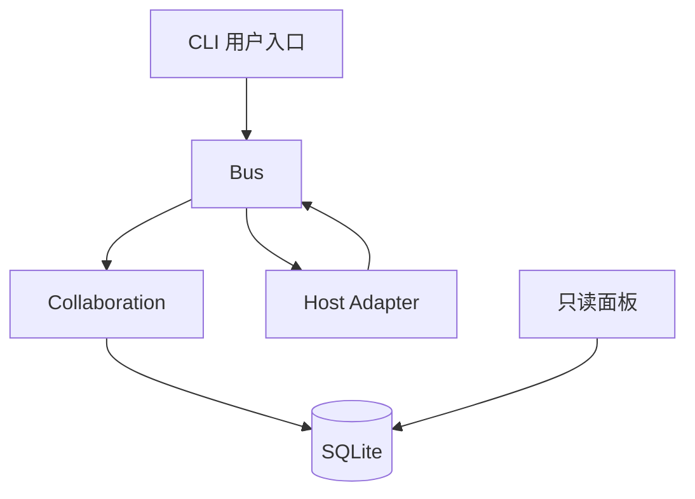

# Agent Team 协作技术设计

日期：2026-10-21
状态：当前实现

实现遵循[协作责任模型](./collaboration-concept.md)。核心原则是：自然语言消息承载协作，`Collaboration` 模块集中校验契约、工作项、证据与收尾，宿主适配器负责实际执行策略和真实事件。

## 1. 模块边界



| 模块 | 职责 |
| --- | --- |
| `src/bus.mjs` | 身份认证、消息路由、队列、回合生命周期、宿主调用和恢复入口 |
| `src/collaboration.mjs` | 契约、工作项、证据、审查、接受、收尾状态与结构性校验 |
| `src/store.mjs` | SQLite 迁移、事务、消息、回合、附件、来源与查询 |
| `src/tools.mjs` | 各角色和上下文可见的框架工具及参数校验 |
| `src/hosts/*` | 把策略映射为宿主参数，报告会话、接受、事件、模型和结束事实 |
| `src/server.mjs` | Unix socket RPC、可信控制入口、只读 HTTP/API 和静态面板 |
| `web/` | Vue 只读观测面板 |

框架不提供统一文件编辑器、工作流 DSL、通用网络沙箱或分布式协调层。

## 2. 持久化

主要表及职责：

| 表 | 内容 |
| --- | --- |
| `preparations` | 建群准备、契约草案、revision、hash、准备会话与最终群 |
| `contract_versions` | 群、版本、契约正文、hash、用户确认来源 |
| `team_state` | 整体 revision、目标版本、有效契约版本、当前目标执行阶段、目标结果和最终交付 |
| `work_items` | 目标版本、工作项 revision、状态和已校验正文 |
| `work_records` | 目标版本、追加式工作项、接受、用户决定、收尾和关闭记录 |
| `change_requests` | 契约与成员变更提案、基准版本和用户决定 |
| `collaboration_operations` | `operationId` 的命令 hash 与幂等结果 |
| `runtime_attempts` | 每个框架回合的宿主运行、策略、契约版本及结束状态 |
| `messages`、`message_context` | 群消息及逐消息工作项/契约版本关联 |
| `message_dispositions` | 完成当前目标时每条遗留消息的处理去向 |
| `outbox`、`attached` | 待投递输入、宿主接受边界与消息附件关系 |
| `turns`、`native_turn_refs` | 框架回合、宿主会话及可用的原生回合引用 |
| `history`、`message_origins` | 宿主事件、工具调用/结果和消息发送锚点 |
| `user_outputs` | 按目标版本持久化的最终用户交付 |
| `role_names` | 团队历史中规范化后唯一的角色名称，删除角色后仍保留 |
| `endpoint_session_bindings` | endpoint 与 Adapter 提供会话域之间的物理 session/thread 绑定 |
| `endpoint_session_policies` | 每个会话域最近一次实际应用的能力签名 |

契约版本和变更记录追加保存。当前状态更新与操作幂等结果在同一事务提交。旧数据库采用增量迁移；旧群若没有确认契约，只保留历史浏览，不自动获得新流程授权。

## 3. 建群与契约确认

流程：

```text
用户提出目标
  → 主 Agent 在 preparation 会话整理契约
  → propose 生成新 revision 与 hash
  → 用户查看并对指定 revision/hash 确认
  → 同一事务创建群、契约 v1 与成员
  → 成员自述能力
```

`preparation` 使用独立来源 key，只能读取准备记录和提交契约草案，不能创建群。可信确认入口调用 `confirmPreparation`；同一准备重复确认返回已有群。

`contract_change_request` 只创建 `pending` 请求。用户通过 `decideRequest` 对当前契约版本批准或拒绝；有运行回合时不能批准变更。批准后追加新契约版本并增加整体 revision。

## 4. 身份、工具和调度

每个 endpoint 固定绑定成员、群、上下文和随机来源 key：

- 主 Agent 私聊：`private`
- 主 Agent 团队调度：`coordination`
- 成员入群自述：`profile`
- 普通双人上下文：`pair:<peerMemberId>`

框架工具不接受模型自报身份。来源 key 只通过宿主私有 MCP 配置和环境传递。工具调用还校验当前运行回合；过期回合不能继续写消息或状态。

路由规则：

- 成员发给主 Agent 的 `send` 进入 coordination。
- 发给普通成员的消息进入对应的 pair endpoint。
- coordination 同群串行；多个成员到达的正式消息可在下一次输入中按 seq 合并，并保留作者和 `workItemId`。
- 普通成员不同对话可并行，同一对话串行并合并积压消息。

用户私聊使用独立 endpoint，不写共享 `messages` 或公开 `history`。用户明确共享的指令通过 `directive` 写入 coordination。

## 5. 工作项管理

`work_item_update` 和 `team_finish` 只对角色为 lead 的 coordination endpoint 开放。所有管理命令携带整体 revision 和唯一 `operationId`：

```json
{
  "command": "{\"id\":\"...\",\"itemRevision\":2,\"state\":\"in_progress\",\"note\":\"...\"}",
  "revision": 7,
  "operationId": "op-20261021-001"
}
```

协作模块校验：

- 群仍为 `active`；
- 整体 revision 与工作项 revision 都匹配；
- 状态转换合法；
- 参与者属于本群且职责合法；
- 工作项策略没有超过契约；
- 每个参与者的角色收窄策略可由其宿主实际支持；
- 贡献证据和审查引用属于本群正式消息；
- 审查作者独立且成果版本一致；
- 取消有责任覆盖或无关依据；
- 接受前成果、证据和必要审查齐备。

相同 `operationId` 和同一命令返回原结果；同编号不同命令或过期 revision 被拒绝。

## 6. 宿主执行策略

契约决定授权上限；工作项声明访问需求和命令需求；角色在运行时收窄有效策略：

- 主 Agent普通 coordination 回合为 `communication`；
- executor/collaborator 使用工作项策略；
- reviewer 最多为 `read-only`；
- profile/private 回合固定 `communication`。

不同 `mode + allowShell` 的有效策略不会被合并到同一回合。框架计算 `communication` 或 `project` 逻辑域，Adapter 提供物理会话键。适配器记录 `framework.policy`：

- `requested`：契约选择的模式与 `allowShell`；
- `mechanism`：宿主实际工具集、沙箱和审批配置；
- `scope`：该配置覆盖的入口；
- `verified`：当前声明为配置已应用，而不是整机绝对隔离证明。

### Codex

- app-server 管理持久线程；
- `turn/start` 显式传 `readOnly` 或 `workspaceWrite` 沙箱；
- 关闭 shell、统一执行、浏览器、插件、应用、代码模式、图像、skill 和其他配置 MCP；
- 通过 dynamic tools 注册当前角色允许的团队工具；
- `communication` 使用不含项目工具的沟通 thread；
- `read-only`/`workspace-write` 复用项目 thread，通过 `turn/start` 切换沙箱；
- 沟通域和项目域分别持久 session；跨域选择或创建对应 thread，不在旧 thread 中静默热改工具；
- 若原生 `collabAgentToolCall`（spawn、wait、agent 管理等）出现，适配器立即请求中断并让回合失败，防止绕过团队调度或长期阻塞。

### Claude Code

- print 模式使用 `--strict-mcp-config` 和每回合生成的 MCP 配置；
- `communication` 使用空内置工具集合；
- `read-only` 只保留 Read/Glob/Grep；
- `workspace-write` 才加入 Edit/Write，`allowShell` 才加入 Bash；
- `--allowedTools` 与 `dontAsk` 明确预允许入口；恢复时重新应用同一策略集合。

### DSH

- headless 使用 invocation-only patch，不修改用户全局 profile；
- 每次回合加入团队 MCP、会话/存储隔离、sandbox、approval 与策略插件；
- 策略插件在 Agent 创建时显式设置 session sandbox，并通过 Agent scope `tools.restrict` 裁剪工具；
- `workspace-write` 才开放 write/edit，`allowShell` 才开放 bash。

详细配置和证据见[宿主执行策略](./host-execution-policies.md)与[验证记录](./host-permissions-verification-20261021.md)。

## 7. 回合与恢复

每次调用宿主前创建框架 `turnId` 和 `runtime_attempts= running`，持久保存输入消息及附加留言。适配器必须在能够确认时报告：

- `onAccepted`：宿主接受输入边界；
- `onSession`：真实宿主会话；
- `onNativeTurn`：可用的原生回合编号；
- `onEvent`：真实宿主事件；
- `onModel`：请求、会话、助手、结算和核实的模型观测；
- `onPolicy`：请求及实际执行配置。

Adapter 可实现 `sessionKey({ policy })` 声明物理会话域；未声明时框架使用单一 `default` 域并复用 session。框架持久保存每个 endpoint 的会话域绑定，而不是把 Codex thread 规则写进协作核心。

正常结束写 `completed`；中断写 `cancelled`；已知失败写 `failed`。总线重启会把未结束记录标为 `unknown`，阻止受影响群继续派发。用户核实宿主确实停止后，通过可信入口写 `stopped`。

普通失败不自动重试。`retry` 只清除明确失败且宿主未接受的 outbox，保留原消息和留言编号，创建新的运行尝试。

## 8. 收尾事务与竞态

`team_finish` 在 `active` 状态和匹配 revision 下执行：

1. 校验所有工作项已 accepted/cancelled；
2. 校验每项完成条件由 accepted 成果覆盖；
3. 校验每条 disposition 引用的消息属于本群；
4. 计算当前尚未处理的正式消息；
5. 若遗漏任何消息，拒绝收尾并返回 `seq:messageId`；
6. 写入 dispositions、`closing` 与最终交付；
7. 增加整体 revision，并保存 operation 结果。

第 4 至第 6 步处于同一 SQLite 事务，之后 `requireActive` 拒绝新派发，因此不会在检查与完成之间继续生成参与目标执行的待处理消息。

运行回合在 `finally` 删除内存 Map 后调用 `reconcile`。只有：

- `phase=closing`；
- 本群没有运行中的回合；
- 没有待核实运行；
- 没有未处理消息；

才写入 `closed` 和 `user_outputs`。

`closed` 表示当前目标结束，不表示群被删除或停用。`outcome=completed` 时，`communicationOpen` 保持为真：新消息继续保存、排队和投递，但 `policy()` 强制使用 `communication`、禁止命令，消息不能关联旧工作项。主 Agent仍可解释成果和追问，但不能通过管理工具重新派工、重开已验收成果或改写最终交付。没有新消息时群保持空闲；只有用户删除群或终止未完成目标时，正常通信才停止。

用户 `terminate` 原子进入 `closing`、保存 `outcome=incomplete`、取消剩余投递并停止相关运行；全部停止并核实后同样可进入 `closed`，但结果仍为未完成。

`next_goal_request` 用于在 `closed + completed|incomplete` 后提交完整新契约。用户批准时，事务增加目标版本和契约版本，将阶段重置为 `active`，清空当前目标的 outcome、final 和 finish reason；旧工作项与 `user_outputs` 保持原目标版本。聊天本身不会触发该事务。

同一时间只允许一个 `active` 目标。工作项创建、修改、完成条件覆盖和证据引用都绑定当前 `goal_version`；跨目标修改或拿旧成果覆盖新目标是错误。历史工作项和交付在新目标启动后只读。

角色名称以 NFKC、去首尾空白和小写规范化后存入 `role_names`。角色删除只软删除成员并撤销端点，名称与历史记录永久保留；没有恢复接口。新增角色必须使用新名称、成员 ID 和宿主会话。

## 9. 只读 HTTP 与面板

服务只绑定 `127.0.0.1`，校验 Host、同源、GET-only 和启动 Cookie。API 只返回群内公开事实：

- `/api/snapshot`
- `/api/collaboration`
- `/api/messages`
- `/api/history`
- `/api/models`
- `/api/message-trace`
- `/api/turn`

Vue 面板包括群导航、消息时间线、成员、协作状态、宿主会话、模型变化和轨迹视图。协作页读取服务端持久事实，不从聊天正文推断完成。

开发脚本可通过 `AGENT_TEAM_DEV_NO_AUTH=1` 关闭启动 Cookie，但仍保留 Host、同源、GET-only 和本机绑定检查。生产启动始终要求入口链接。

## 10. 验证

规则级测试覆盖：

- 契约确认、版本与幂等；
- 状态转换、revision、证据归属和独立审查；
- 取消责任覆盖、接受重开；
- coordination 合并、私聊隔离和来源校验；
- 收尾遗漏消息拒绝、运行等待和关闭；
- 重启待核实、用户终止与最终输出；
- Codex 原生协同工具中断。

真实宿主验收使用独立 SQLite 和工作目录，至少覆盖纯讨论、实现审查返工、证据缺失终止三类场景，并要求 Codex、Claude、DSH 各产生真实参与证据。最终还需通过生产构建、类型检查、API 和浏览器只读验证。
