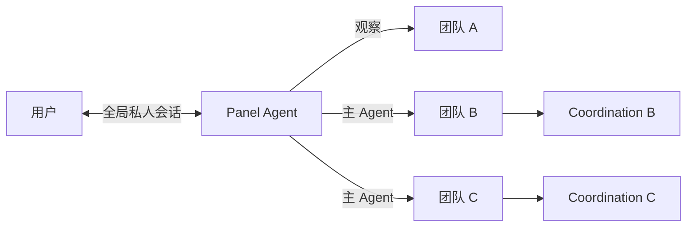
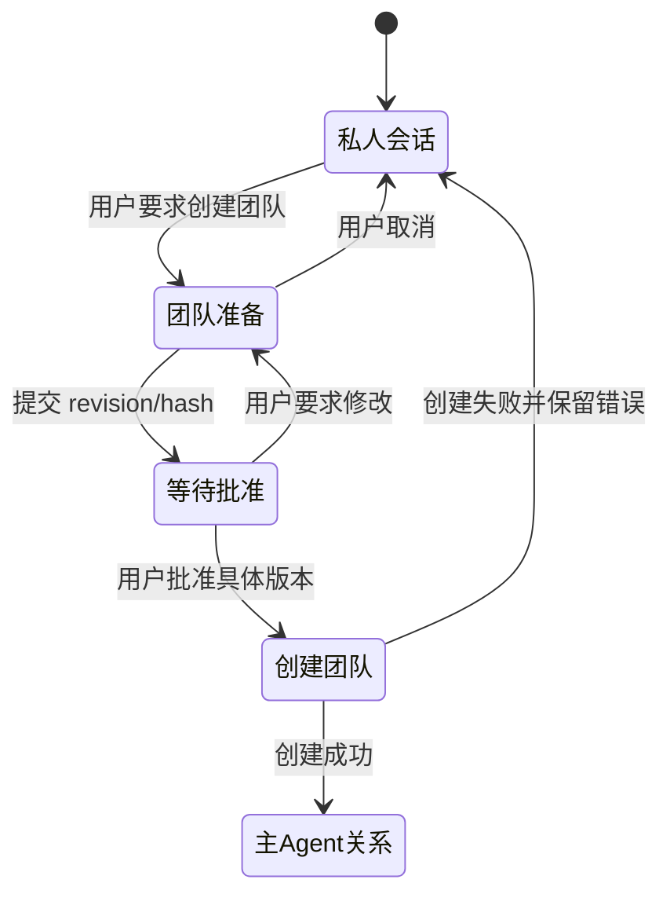

# Panel Agent 设计

日期：2026-10-22
状态：本地实现与验证中

本文定义 Panel Agent 的产品语义、生命周期、权限边界和兼容策略。逻辑验证原型见 [`web/prototypes/panel-agent-lifecycle-logic.html`](../web/prototypes/panel-agent-lifecycle-logic.html)。

## 1. 核心模型

Panel Agent 是面板的用户侧主 Agent 身份。它先于团队存在，可以创建和管理多个团队。



约束：

- 每个数据目录最多一个 Panel Agent。
- Panel Agent 惰性创建；没有创建时，现有 CLI 和只读面板不受影响。
- Panel Agent 使用统一模型配置，模型变化作用于其所有上下文。
- 私人对话只有一条，跨团队连续存在。
- Panel Agent 与团队是一对多关系。
- 对每个团队只有 `observer` 和 `main` 两种关系。
- Panel Agent 不能作为普通成员承担执行或审查工作。
- 每个团队同一时间只有一个可写的主控者。

## 2. 术语

| 术语 | 定义 |
| --- | --- |
| Panel Agent | 数据目录内唯一的全局 Agent 身份 |
| 全局私人会话 | 用户与 Panel Agent 的连续对话，不进入团队共享记录 |
| 团队关系 | Panel Agent 对某个团队的 `observer` 或 `main` 绑定 |
| 观察 | 可读取团队全部共享内容，但不能写入团队状态 |
| 主 Agent | 当前拥有团队 coordination 写权限的控制者 |
| 原主 Agent | 创建团队时的主 Agent，可被暂停并可恢复 |
| coordination | 面向团队工作项、派工、汇报和收尾的上下文 |
| preparation | 团队创建前整理契约的生命周期状态 |

## 3. 生命周期

### 3.1 Panel Agent

```text
不存在
  → 用户创建
  → 存在并可恢复
```

首次打开面板 Agent 页面时：

- 若没有 Panel Agent，显示空状态和创建入口。
- 用户选择名称、宿主、模型和思考强度后才能创建。
- 创建前不调用业务模型。
- 创建后持久保存身份、模型配置、私人会话和团队关系。

### 3.2 团队创建



团队创建复用现有 preparation 流程：

1. Panel Agent 创建 preparation。
2. Panel Agent 收集目标、范围、边界、成员、工作区和完成条件。
3. 框架按当前全局模型策略生成普通角色模型计划，Panel Agent 提交契约草案与模型计划。
4. 面板展示带 revision、hash 和差异摘要的确认卡片。
5. 用户通过可信按钮批准具体版本。
6. 框架原子创建团队、成员和 coordination 上下文，并写入一次幂等的批准后继续事件。
7. Panel Agent 与团队的关系从准备过渡为 `main`。
8. 私人会话消费继续事件，恢复批准前的执行计划。

准备是生命周期状态，不是独立运行模式。

Panel Agent 的团队上下文、草稿和发送状态保存在页面组件之外。离开 Agent 页面不会取消已提交的宿主回合；返回时根据前端提交状态和后端 `running` 恢复 loading，并从持久化上下文恢复当前团队。

团队 coordination 在需要让用户知道进展时，由 Panel Agent 调用 `panel_update_publish`，用自然语言发布团队更新。更新持久化保存，并在 coordination 回合结束后自动交给私人会话；私人会话忙碌时排队。框架自动关联发布时的团队、来源回合和 coordination 回合已处理的正式消息。

coordination 与私人会话隔离。框架不会逐条扫描团队消息并强制生成进度；是否发布更新由 Panel Agent 根据成员正式消息和团队状态自行判断。私人会话忙碌时更新排队，不会并发启动。团队更新只提供事实信息，不能作为用户授权或写操作权限。

用户批准 Panel Agent 创建的 preparation 时，团队创建与批准后继续事件在同一事务中完成。继续事件使用 preparation、revision 和 hash 生成确定性 ID，重复批准不会重复执行。私人会话恢复后获得明确的 `groupId`，继续创建工作项和派发批准前的第一步任务。

### 3.3 接管和交还

Panel Agent 接管已有团队：

```text
observer
  → 用户确认接管
  → 检查团队是否安全暂停
  → 原主 Agent 暂停
  → Panel Agent 激活 main 关系
  → 新建或恢复该团队的 coordination 上下文
```

接管前置条件：

- 团队没有活动回合。
- 没有待核实运行。
- 没有未处理正式消息。
- 用户批准了具体接管操作和目标版本。

交还：

```text
main
  → 用户确认交还
  → 检查团队是否安全暂停
  → Panel Agent coordination 转只读
  → 原主 Agent 恢复
  → Panel Agent 回到 observer
```

历史消息、宿主会话和身份归属不能转写或合并。

## 4. 会话与团队上下文

全局私人会话是唯一用户对话容器。团队信息按需读取，不自动把所有团队内容加入模型输入。

每轮调用至少记录：

```json
{
  "panelAgentId": "...",
  "conversationId": "...",
  "activeTeamId": "...",
  "relation": "observer",
  "turnId": "...",
  "inputMessageId": "..."
}
```

规则：

- 所有团队工具调用必须显式携带 `teamId`。
- 用户切换团队后，新回合才使用新的 `activeTeamId`。
- 会话列表按当前上下文显示：选中团队时只显示 `active_team_id` 等于该团队的消息，全局上下文只显示无团队归属的消息；底层私人会话仍完整保留。
- 已经开始运行的回合锁定原团队上下文。
- 全局私人会话与团队 coordination 是同一个 Panel Agent 的两个隔离上下文；coordination 会因团队消息自动运行，不是外部进程或第二个 Panel Agent。
- 没有团队上下文时，不能解析“这个团队”并执行写操作。
- 回答引用实际团队、消息、回合或工作项来源。
- 跨团队查询返回结构化团队标识，不拼接无来源的长文本。
- 跨团队写操作第一版不支持；需要逐团队确认。

观察所有团队表示“可查询所有团队”，不表示每轮加载所有团队详情。

## 5. 权限边界

| 能力 | observer | main | 原主 Agent |
| --- | --- | --- | --- |
| 读取共享消息、成员、工作项、轨迹、交付 | 是 | 是 | 是 |
| 写入团队消息 | 否 | 是 | 暂停时否，恢复后是 |
| 管理 work item | 否 | 是 | 暂停时否，恢复后是 |
| 请求契约变更和新目标 | 否 | 是 | 暂停时否，恢复后是 |
| 请求团队收尾 | 否 | 是 | 暂停时否，恢复后是 |
| 查看原主 Agent 私人会话 | 否 | 否 | 本人上下文可用 |
| 读取项目文件或执行命令 | 否 | 否 | 按原团队规则 |

Panel Agent 即使担任主 Agent，也只负责团队协调。项目执行仍由契约允许的普通角色完成。

## 6. 模型与会话

- Panel Agent 使用一份模型配置。
- 全局私人会话和所有团队 coordination 使用同一模型配置。
- 每个团队拥有独立 coordination session。
- 同一团队的 coordination 回合串行。
- 不同团队的 coordination 可以并行。
- 团队上下文切换不能复用其他团队的运行锁、消息游标或工作项 revision。
- 接管后不继承原主 Agent 的模型或宿主会话。

## 7. 工具边界

观察工具：

- `teams_list`
- `team_snapshot`
- `team_messages_read`
- `team_members`
- `team_collaboration_read`
- `team_message_trace`
- `team_turn_trace`
- `model_catalog`

准备工具：

- `team_preparation_create`
- `preparation_read`
- `contract_propose`
- `team_plan_update`

主 Agent 工具：

- 现有主 Agent 工作项工具；
- 团队 `send`、`contract_change_request`、`next_goal_request`；
- `panel_update_publish`，向私人会话发布自然语言团队更新；
- `team_finish`、`finish_withdraw`；
- `team_takeover_request`、`team_handback_request`。

模型可以发起接管或交还请求，但必须由用户确认操作。模型不能自行批准 preparation、接管或交还。

`work_item_update` 和 `team_finish` 的 `command` 是结构化 JSON 对象，不以扁平字段猜测命令格式。工作项取消必须使用：

```json
{
  "id": "work-item-id",
  "itemRevision": 3,
  "state": "cancelled",
  "cancellation": {
    "kind": "irrelevant",
    "reason": "该临时项与团队目标无关"
  }
}
```

团队收尾必须提供 `outcome`、`final`、`note`、`coverage`，并由 `coverage` 为每个契约完成条件引用当前目标中的已接受工作项。coordination 会话不得创建临时探针或修改真实工作项来试探工具参数；参数失败时应读取明确错误并停止该操作。

## 8. 面板 API

现有团队观测页保持只读。Panel Agent 通过独立受限命令完成私聊、准备确认和控制者切换：

| 方法 | 路径 | 用途 |
| --- | --- | --- |
| `GET` | `/api/panel-agent` | 读取身份、模型配置和连接状态 |
| `POST` | `/api/panel-agent` | 惰性创建 Panel Agent |
| `GET` | `/api/panel-agent/conversation` | 分页读取全局私人会话 |
| `POST` | `/api/panel-agent/messages` | 发送 Panel Agent 私人消息 |
| `POST` | `/api/panel-agent/stop` | 停止当前 Panel Agent 回合 |
| `GET` | `/api/panel-agent/teams` | 读取观察和主控关系 |
| `POST` | `/api/preparations/:id/approve` | 使用可信确认授权批准具体版本 |
| `POST` | `/api/teams/:id/takeover` | 请求 Panel Agent 接管 |
| `POST` | `/api/teams/:id/handback` | 请求交还原主 Agent |
| `POST` | `/api/panel-actions/:id/decide` | 用户确认或取消 Panel Agent 发起的接管/交还请求 |

所有写接口必须：

- 只接受同源请求；
- 校验 Host、`Sec-Fetch-Site`、HTTP 方法和 JSON Content-Type；
- 限制请求体大小；
- 使用当前面板会话鉴权；
- 对确认动作发放一次性、短期、绑定具体操作内容的授权；
- 在事务中校验团队控制 revision，拒绝并发覆盖。

## 9. 持久化建议

新增表或等价结构：

| 数据 | 关键字段 |
| --- | --- |
| `panel_agents` | id、name、host、model、effort、status、created |
| `panel_sessions` | panel_agent_id、context、session、created、updated |
| `panel_conversations` | conversation、role、text、active_team_id、created |
| `panel_turns` | turn_id、conversation、active_team_id、runtime_state |
| `panel_team_bindings` | panel_agent_id、group_id、relation、created、updated |
| `team_lead_controllers` | group_id、controller_kind、controller_id、state、revision |
| `confirmation_grants` | action、payload_hash、expires、consumed |
| `controller_transitions` | group_id、from、to、reason、created |

必须保持：

- Panel Agent 不写入 `members` 表。
- Panel Agent 不伪装成 lead 成员。
- 每个团队最多一个 active controller。
- 团队消息和来源名称可以解析成员或 Panel Agent actor。
- 控制器切换使用独立 revision 和幂等 operation ID。

## 10. 兼容策略

- 现有 CLI 创建团队、契约变更、私聊和协调流程保持可用。
- 未创建 Panel Agent 时，现有只读面板保持现状。
- Panel Agent 创建后，已有团队自动解析为 `observer`。
- 后续新建团队自动写入观察绑定。
- 原主 Agent 身份、私有历史、coordination 历史、模型和会话全部保留。
- Panel Agent 接管不会修改原主 Agent 的历史归属。
- 现有团队仍可通过原生会话 Agent 使用。
- 两种入口共享团队事实，但私人会话互不可见。

## 11. 可信确认

用户不需要输入 CLI 命令。Panel Agent 可以调用 preparation 和批准工具，但批准必须依赖用户操作：

1. 面板展示契约 revision、hash、差异和确认摘要。
2. 用户点击“批准此版本”。
3. 服务端生成绑定 `{preparationId, revision, hash}` 的一次性授权。
4. Panel Agent 调用批准接口时提交该授权。
5. 框架验证后原子创建团队。

模型生成的确认文本、工具参数或消息内容不能代替用户确认。

## 12. 非目标

- Panel Agent 作为普通团队成员。
- 多个 Panel Agent 共享一个数据目录。
- 跨数据目录观察。
- 自动把所有团队上下文注入模型。
- 一个用户回合隐式操作多个团队。
- 接管过程中让原主 Agent 继续写入。
- Panel Agent 直接执行项目代码或命令。
