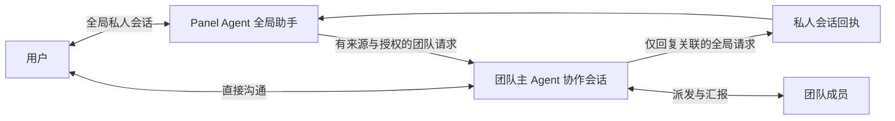

# Panel Agent 与团队统一会话：设计与实施方案

日期：2026-10-25
状态：核心投递、显式回执、工具隔离、导航与历史兼容已实现；验收证据见本文末尾。

依据：[通信内核优先 ADR 0004](./adr/0004-revert-to-communication-core.md)、[团队指令入口](./team-directives.md)。本方案针对当前通信模型，不恢复目标、工作项、契约或收尾状态机。

## 1. 已确认的决定

保留 Panel Agent 担任团队主 Agent 的能力。改变的是消息路由与会话职责，不是角色模型。

- 用户有一条与 Panel Agent 的全局私人会话。
- 每个团队有一条主 Agent 协作会话，承接用户指令与成员正式汇报，串行处理。
- Panel Agent 可以同时担任多个团队的主 Agent；每个团队的协作上下文独立。
- 用户既可以从全局私人会话提出团队要求，也可以进入团队直接与主 Agent 沟通。
- 两种入口的团队执行请求最终进入同一条团队协作会话。
- 团队内直接对话不自动复制到私人会话；从私人会话发起的请求可在私人会话收到关联回执。
- 成员之间的双人会话、用户与普通成员的会话继续存在。“统一团队会话”指主 Agent 的处理上下文，不是合并全部成员上下文。

## 2. 身份、角色、入口

| 对象 | 职责与约束 |
| --- | --- |
| 用户 | 决定意图和授权，可使用全局入口或团队入口 |
| Panel Agent 身份 | 数据目录内的全局身份，可以是观察者，也可以担任团队主 Agent |
| 全局助手角色 | 在私人会话中做跨团队咨询、创建与管理、请求转交、按需汇总 |
| 团队主 Agent 角色 | 在该团队协作会话中处理用户指令、协调成员与接收汇报 |
| 团队 | 独立通信空间，保存共享消息、成员及当前主控关系 |

Panel Agent 自己担任主 Agent 时，转交是“私人上下文 → 自己的团队协作上下文”；其他 Agent 担任主 Agent 时，转交是“私人上下文 → 该主 Agent 的协作上下文”。两者都不在私人上下文内并行开展第二套团队协调。

## 3. 当前实现与差异

以下是代码核查结果，不代表目标设计已经生效。

| 当前路径 | 当前行为 | 需要调整 |
| --- | --- | --- |
| `TeamDirectiveComposer` → `TeamDirectives.submit` → `Bus.directive` → `pump` | 用户消息写入团队 `messages`，投递当前主 Agent 的 coordination | 保留，作为统一团队处理入口 |
| `Bus.panelMessage` | 用户消息写入私人 `panel_messages`；`activeTeamId` 只是上下文标签 | 保留全局私人会话，移除把团队标签表现为独立聊天的 UI |
| `panel_update_publish` → `panel_updates` → `pumpPanelUpdates` | 团队更新自动唤醒私人线程，由其再次生成回复 | 取消默认自动中转，改为明确的请求回执或来源通知 |
| 私人线程的团队写工具 | 主控关系下可直接协调成员 | 私人线程改为转交团队请求，不直接开展成员协调 |
| `panel-agent` 前端 store | 按 `active_team_id` 保存私人消息未读 | 全局私人会话与团队消息分别归属，不再靠团队标签共享已读位置 |

主要代码位置：`src/bus.mjs`、`src/panel-tools.mjs`、`src/team-directives.mjs`、`src/store.mjs`、`src/prompts.mjs`、`web/src/features/panel-agent/`、`web/src/pages/GroupWorkspacePage.vue`、`web/src/stores/panel-agent.ts`。

## 4. 通信规则

### 4.1 团队入口

用户在团队页面发送消息 → 原子写入用户指令 → 当前主 Agent 的协作队列 → 团队中显示回复。

- 不唤醒私人线程，不生成私人消息副本。
- 保留用户指令操作编号、消息编号、回复关联及现有失败重试规则。
- 主 Agent 正忙时进入同一协作队列，不创建第二条并发协作会话。

### 4.2 全局入口

用户在私人会话中要求某团队开展工作 → 全局助手明确目标团队和转交内容 → 创建关联的团队请求 → 团队主 Agent 在协作会话中处理。

- 全局咨询、读取团队信息和汇总可在私人线程完成，无须转交每次查询。
- 同一用户请求涉及多个团队时，每个目标团队有独立转交关联与操作编号。
- 转交成功后展示团队链接与“已投递／排队”等通信事实，不把收到消息说成事情已完成。
- 等待团队结果时结束私人回合，允许用户继续全局对话；不阻塞等待宿主线程。

### 4.3 权限与来源

一期仅允许 Panel Agent 向其担任主 Agent 的团队转交执行请求，沿用现有主控写权限。观察关系继续只读；需要执行时沿用已有接管确认流程，不因用户选择团队或出现转交文字而获得写权限。

- 不能把任意模型文本或团队消息升级为可信用户指令。
- 关联必须绑定真实私人用户消息、发起回合、目标团队及提交时主控身份；服务端验证来源和当前权限。
- 存储原始用户要求与 Agent 整理的转交文本，两者可追溯，整理文本不得扩张授权。
- 重试仍使用原始操作编号与接收者；主控变化沿用现有冲突处理，不静默改投。
- 接管、交还、成员管理等既有确认要求继续生效。
- 私人会话访问级别不扩散到团队；团队协作和成员执行继续使用既有执行策略。

向其他主 Agent 团队转交的角色路径保留在设计中；开放前需要明确独立的委托权限，不能复用“观察即可控制”的隐式规则。

## 5. 请求关联与回执

集中在一个通信 Module 内处理关联、幂等、投递与回执，两个入口通过同一 Interface 进入现有指令机制，避免在工具、前端和消息泵分别实现规则。

建议的 Interface（名称为提案）：

- `submitTeamRequest(source, teamId, text, operationId)`：验证来源与权限，复用指令投递，返回团队消息引用。
- `publishTeamReceipt(requestId, sourceMessageIds, text)`：验证团队与来源，保存关联回执，供全局私人会话显示。

最小关联信息：来源入口、原始私人用户消息 ID（团队直接输入时为空）、发起回合／工具调用 ID、团队 ID、提交时控制者 ID、团队指令消息 ID、幂等操作编号、回执及来源消息引用。

这只是通信关联，不引入任务计划、完成状态机或自动判断任务成功。

回执规则：

1. 自动接收回执只说明持久化／排队／投递事实，不调用模型重新总结。
2. 主 Agent 需要回应全局请求时，显式发布带请求关联及来源消息的自然语言回执。存在多个请求时必须指定关联，不能把整个回合输出广播给所有请求。
3. 一期回执以结构化引用卡片显示在私人会话中，不自动唤醒私人宿主；用户追问时才按需读取团队事实。
4. 团队直接输入没有私人请求来源，不产生私人回执。
5. 需要用户选择、确认或输入的事情继续使用 `ask`，卡片归属原始团队会话；私人入口可显示链接，不复制可独立作答的卡片。
6. 后台团队进展可以主动发布来源通知，但不自动变成私人聊天消息、不自动运行私人 Agent。

## 6. UI 与通知

- Panel Agent 页面只有全局私人聊天；团队关系列表改为团队导航，显示关系和待处理提示。
- 点击团队进入团队页面；Panel Agent 担任主 Agent 时仍清楚显示“Panel Agent 主控”。
- 旧 `agent?team=…` 链接转到对应团队。旧私人历史提供单独的只读筛选入口，不继续把旧链接解释为可写团队私聊。
- 私人会话中的请求回执显示目标团队、通信状态与来源链接，可进入团队继续对话。
- Panel Agent 侧栏未读只统计全局私人消息与待阅读的请求回执；同一回执的展示副本不新增未读。
- 团队消息未读归属团队会话；当前正在显示的消息标为已读，不能因为查看群消息就清除未展示的成员私人会话消息。
- 原始团队回复与私人关联回执用来源消息引用去重；已读来源回复不再次触发同一回执的提醒。回执新增独立内容时才产生新的提示。
- 待答复互动与普通未读分开；标为已读不代表已经回答互动。
- toast、回执和未读都指向同一持久化来源；流式内容只作展示，不能作为唯一消息记录。

## 7. 兼容与迁移

- 保留现有身份、主控关系、宿主会话、团队消息和私人历史，不重建全部宿主上下文。
- 历史 `active_team_id` 继续用于检索，但不作为新团队私聊的路由依据。
- 不把历史私人聊天批量重放进团队，避免产生新的执行。
- 旧 `panel_updates` 保留审计可读性。升级时停止旧自动唤醒逻辑；未交付记录转为可查看的历史通知，不自动重新执行私人回合。
- `panel_update_publish` 在兼容期返回已持久化的来源通知，但停止唤醒私人线程；新工具描述和提示词同步切换，不能只改说明而保留旧副作用。
- 已运行回合使用原有投递关联收尾；部署选择无运行回合的窗口，不能在新旧协议间重投输入。
- 版本化前端未读数据；已有读标记尽量按来源保留。无法可靠关联的历史消息作为迁移基线，不把全部历史重新报为未读，也不伪造已答复状态。

## 8. 实施顺序

| 阶段 | 修改范围 | 完成条件 |
| --- | --- | --- |
| 1. 通信关联与投递 | 新通信 Module、指令入口、最小关联持久化、来源验证 | 两个入口最终进入同一团队协作会话，重试无重复消息 |
| 2. 工具与提示词 | 私人线程的团队协调工具改为请求转交；团队线程保留主 Agent 工具 | 私人线程不能直接开展第二套成员协调，Panel Agent 仍可担任主 Agent |
| 3. 回执与通知 | 关联回执、停止自动私人唤醒、旧更新兼容 | 团队直接聊天不产生私人副本，回执只返回其来源请求 |
| 4. 前端入口 | 全局聊天、团队导航、请求回执卡、旧链接兼容 | 用户能明确判断当前对话归属，可到团队接续对话 |
| 5. 未读与恢复 | 按来源去重、独立互动待办、读标记迁移、缓存恢复 | 切换／刷新／重连后计数与可见来源一致 |
| 6. 联合验收 | 协议集成测试、浏览器操作、实际宿主最小通信 | 下列矩阵通过，再安排切换 |

每阶段代码可以分开提交，但上线切换必须覆盖投递、工具、通知与 UI 的完整路径，避免新入口配旧自动同步。

## 9. 验收矩阵

| 场景 | 必须验证 |
| --- | --- |
| Panel Agent 是主 Agent，团队页发问 | 协作线程收到一次；团队回复一次；私人宿主不被唤醒；无私人重复未读 |
| Panel Agent 是主 Agent，全局入口发起团队工作 | 私人请求与团队输入关联；同一团队协作线程执行；私人显示关联回执 |
| Panel Agent 为观察者 | 可查询；执行转交受既有权限限制；不能默默接管 |
| 其他 Agent 为主 Agent，团队页发问 | 保持原有指令投递、回复与重试行为 |
| 两个入口同时向同一团队提交 | 进入同一串行队列；幂等身份分别稳定；不漏消息、不重复执行 |
| 同时控制多个团队 | 来源、目标、回执、互动和未读不串团队 |
| 回合批量消费多个用户／成员输入 | 不能将无关最终输出复制给所有私人请求 |
| 团队后台主动通知 | 来源可定位；不自动唤醒私人线程；没有双份互动卡 |
| 归档、主控变更、未知运行、失败重试 | 沿用现有阻断与核实规则；不静默更换收件者或自动重放 |
| 切换团队、刷新、断线重连 | 持久化消息完整；可选会话参数规范化；确认卡与 toast 指向同一来源 |
| 升级后的历史数据 | 无旧输入重放；旧更新不自动触发私人宿主；旧链接可用；历史不批量报未读 |

实际宿主验收只做最小纯通信，不要求文件修改；执行前使用明确的验收指令和空闲服务窗口。fixture 结果与实际宿主证据分别记录。

## 10. 实施前需落实的选择

核心模型已确定，以下采用本方案默认值进入实现细化：

- 一期观察关系不开放执行委托；跨主 Agent 委托作为后续显式权限扩展。
- 私人回执默认使用引用卡片，不自动调用私人模型做二次总结。
- 完成状态由主 Agent 的自然语言说明表达，框架仅记录通信与投递事实。

## 11. 实施记录（2026-10-25）

- `TeamRequests` 统一保存私人用户来源、转交消息和操作编号；复用 `TeamDirectives` 原子投递。
- 私人 `team_send` / `team_note` / 成员管理工具已移出私人 schema；协调能力留在团队线程。
- `team_request_submit` 校验真实私人用户回合与当前主控关系；`team_receipt_publish` 校验团队、来源与幂等编号。
- 回执保存一条权威团队回复，私人卡片引用这条消息，不再让私人模型二次生成结果。
- 旧 `panel_updates` 保留为来源通知；停止自动私人唤醒。全局停止按钮只停止私人回合，不中断团队协作。用户对私人互动的显式答复仍可继续私人回合。
- Panel Agent 页面仅可写全局会话；旧团队私聊只读；旧团队链接进入团队页面。
- 私人消息与回执分别记录已读，已读团队来源副本去重；互动答复状态独立保留。
- 新表追加迁移，不重放历史私人消息或旧更新；后台模型配置与角色身份保持不变。

验证覆盖：原子失败回滚、转交和回执重复调用、观察关系拒绝、私人直接协调拒绝、伪造来源拒绝、跨团队回执拒绝、全局与团队入口隔离，以及未读的来源副本去重与刷新恢复。实际宿主与浏览器验收结果在完成后追加。

### 本地联合验收结果

- 全量回归：122 项后端测试、68 项前端测试通过；语法、类型检查和构建通过。
- 实际宿主：使用当前 Panel Agent 的 DSH 宿主完成一次全局请求转交。私人回合（完整 ID 见本地证据）仅转交并回复“已转交”；团队协作回合完成 `team_requests` → `team_receipt_publish`，保存 `TEAM_CONTEXT_ACCEPTED_UNIFIED_CONTEXT_20261025` 回执，没有二次私人自动回复。
- 实际团队直接入口：回复 `DIRECT_CONTEXT_ACCEPTED_20261025`；前后私人回合总数均为 105，没有新增私人回合或副本。
- 浏览器：已确认全局回执卡片与来源跳转、旧团队链接重定向、旧团队私聊无输入框且只读。
- 证据：`work/panel-team-conversation-acceptance/`，包含切换前 SQLite 备份、私人请求结果、团队请求／工具调用关联、直接入口前后计数。验收使用纯通信，未要求成员执行文件或命令操作。
- 观察关系下的执行委托保持未开放；角色模型未改变。
