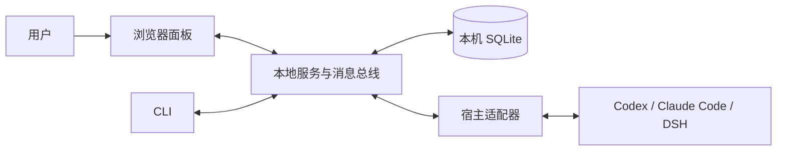

# 架构与通信

[返回产品介绍](../README.md) · [术语表](../GLOSSARY.md) · [宿主适配](host-adapters.md)

## 本地 B/S

浏览器提供界面，Node ESM 服务负责本地消息总线、调度、HTTP API 与宿主接入；SQLite 保存框架记录。面板仅绑定 `127.0.0.1`，生产前端与 `/api/*` 同源。CLI 通过本地 IPC 通信：Unix socket 或 Windows named pipe。

启动器负责默认数据位置、实例发现、重复启动复用、就绪检测和打开浏览器。它不增加桌面 WebView，也不把模型服务托管到框架中。程序与用户数据分离，模型认证和执行由宿主负责。

此图表达本机组成关系；宿主调用模型时可能访问外部服务，不意味着完全离线。

## 会话与消息

- 每个团队拥有一个主 Agent 的调度会话。所有成员向主 Agent 的正式汇报进入这里串行处理；忙碌期间输入按顺序合并。
- 普通成员之间使用独立双人上下文；不同双人会话可并行，不把所有人的对话合成一条巨大上下文。
- `send(to,text)` 记录正式消息并唤醒接收方；`note(to,text)` 不唤醒，随下一条正式输入合并。
- `read` 分页读取群记录，`members` 查看成员，`profile_set` 只更新自己的能力自述。
- `ask` 发出互动卡并立即返回。成员结束当前回合，用户回答后再开启下一回合。
- 等待新消息时成员应结束回合，由框架再次唤醒；宿主原生子 Agent 和阻塞等待工具被裁剪。

框架负责消息路由、回合调度、投递安全与宿主接入。分工、审阅充分性和结果是否可接受，由 Agent 的消息与用户判断组织，没有框架级强制业务流程。

## 私人助手与团队

私人助手是一条全局私人会话，可以观察多个团队的共享记录。它与各团队的协调会话分开：私人发起的请求经 `team_request_submit` 转交，团队通过 `team_receipt_publish` 返回来源引用回执。直接团队对话不自动复制到私人历史；团队来源通知不自动唤醒私人模型。

用户可通过互动卡确认私人助手接管或交还团队协调职责。接管改变主控关系，不能扩大文件权限。

## 权限与恢复

群执行策略为 `communication | read-only | workspace-write`。私人会话另有只读、工作区写入与完全权限；团队调度仍只协调，不读写项目文件。逻辑域分 `communication` 与 `project`，物理会话由 Adapter 决定。Codex 分开使用沟通与项目 thread，Claude/DSH 可复用 session；每回合记录请求策略和实际配置。

服务保留四项关键约束：

1. 不确定运行标记为 `unknown` 并阻塞后续投递，用户核实后才解除，不自动重放。
2. 用户指令使用持久请求编号，防止网络重发重复派发；页面建群与首条需求分别幂等。
3. 停止服务不删除团队、配置和已保存消息；重启保留恢复语义。
4. 宿主不支持请求策略时拒绝回合，不静默降级权限或切换模型。

团队只区分 `open` 与 `archived`。归档暂停投递，可恢复；不代表结果已验收。

归档时保存一份独立事实快照（团队说明、成员任务清单、现存消息和互动），不调用模型。用户在设置页查看时，由 Panel Agent 使用无工具、communication 策略的独立 `archive-summary` 会话生成摘要并缓存；不混入私人聊天。快照材料不随历史清理删除。恢复团队时删除快照与摘要、取消生成；再次归档重新创建。旧归档团队不补造过去快照，恢复再归档后才有快照。产物只保存消息中的引用，不复制文件。

## 面板传输与本地接口

团队页通过 SSE 接收主 Agent 回复和成员通信的参数增量；重连时使用完整草稿快照恢复。事件视图仅包含适配器观察到的内容。

HTTP 接口保留 Host、跨站、请求方法及回环地址绑定检查，写接口校验 Origin。默认本地面板不使用登录账号或 Cookie，不应直接作为公网服务部署。

## 对应实现

| 内容 | 入口 |
| --- | --- |
| 启动、服务与 IPC | [launcher.mjs](../src/launcher.mjs)、[server.mjs](../src/server.mjs)、[rpc.mjs](../src/rpc.mjs) |
| 消息与调度 | [bus.mjs](../src/bus.mjs)、[message-dispatch.mjs](../src/message-dispatch.mjs) |
| 存储 | [store.mjs](../src/store.mjs) |
| 私人会话、请求与回执 | [panel-sessions.mjs](../src/panel-sessions.mjs)、[team-requests.mjs](../src/team-requests.mjs) |
| 前端设计基线 | [DESIGN.md](../DESIGN.md) |

团队删除复用 `GroupLifecycle.deleteGroup`：执行期间通过内存互斥阻止同团队的新回合，等待完整回合收尾后，以事务清理数据库记录（含没有外键的协调消息、工作台隐藏记录及遥测会话代数）。Panel 私人消息保留并解除团队引用。归档快照和摘要随团队级联删除；项目工作目录及宿主原生历史保留。面板永久删除入口只接受归档团队；旧 CLI/Agent 入口保持原有适用范围。数据库提交后的框架缓存清理失败单独返回警告，不伪报团队删除失败。
