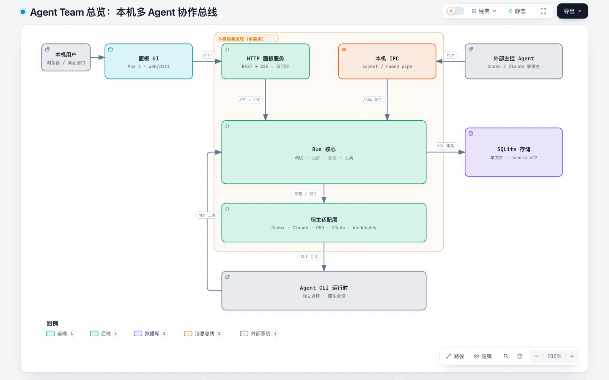
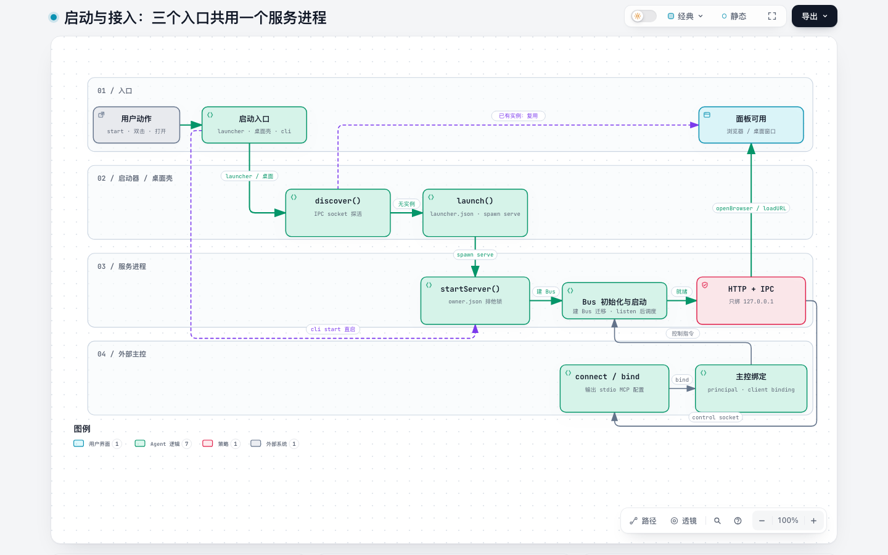
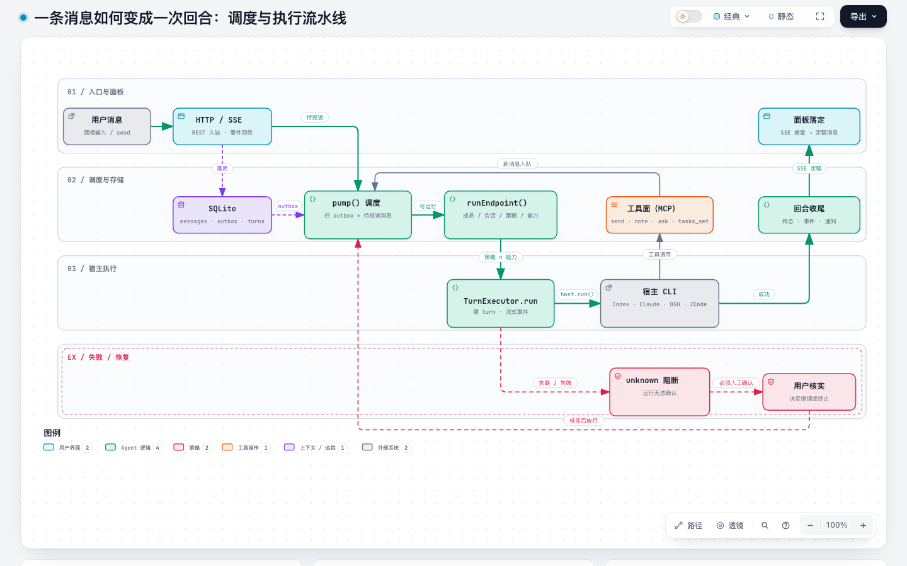
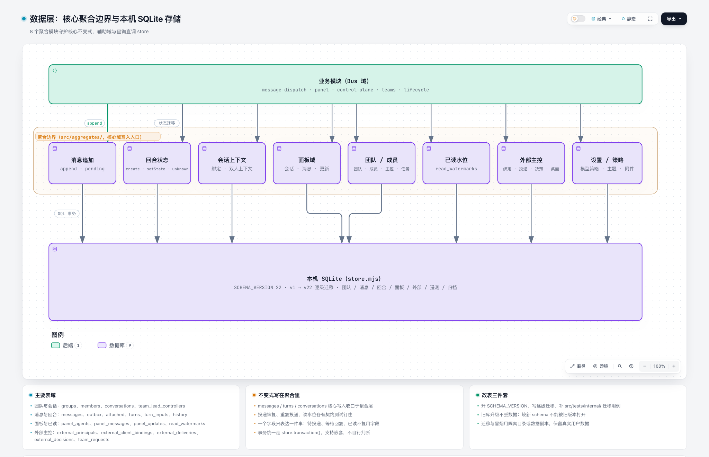
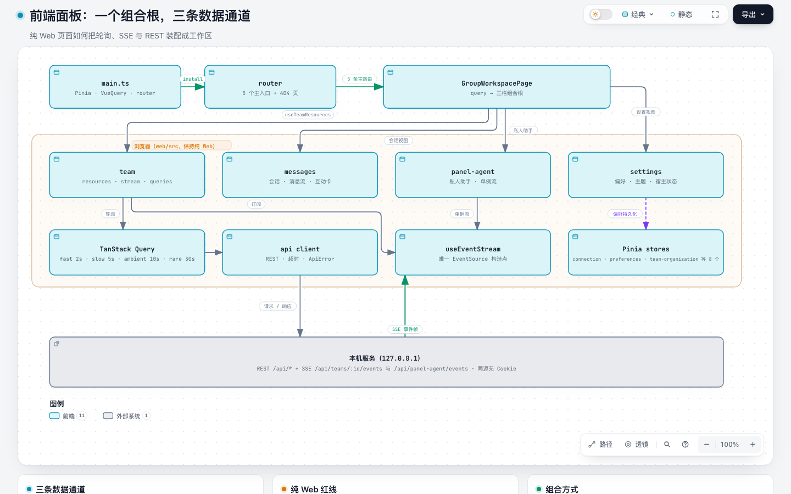

# 架构与通信

[返回产品介绍](../README.md) · [English](en/architecture.md) · [术语表](../GLOSSARY.md) · [宿主适配](host-adapters.md)

## 本地 B/S 与整体边界

浏览器与 Electron 桌面窗口共用同一份 `web/dist` 前端；Node ESM 服务负责本地消息总线、调度、HTTP API 与宿主接入；SQLite 保存框架记录。面板仅绑定 `127.0.0.1`，生产前端与 `/api/*` 同源。CLI 与外部主控通过本地 IPC 通信（Unix socket 或 Windows named pipe）。

<picture>
  <source media="(prefers-color-scheme: dark)" srcset="../assets/architecture/overview-dark.png">
  
</picture>

- 程序与用户数据分离，模型认证和执行由宿主独立子进程负责，不托管进服务进程内存；宿主调用模型时可能访问外部服务，不意味着完全离线。
- ZCode 是桌面应用携带的内置 CLI；WorkBuddy 是外部 MCP 主控，不作为成员工厂启动。项目自己的 Electron 桌面窗口只是第一方面板入口（`loadURL(instance.url)`），不是模型宿主。

## 启动、单实例与三入口接入

<picture>
  <source media="(prefers-color-scheme: dark)" srcset="../assets/architecture/entry-dark.png">
  
</picture>

- **两条启动路径**：[launcher.mjs](../src/launcher.mjs) 与桌面壳（[electron/service.mjs](../electron/service.mjs)）先通过 `discover()` 探测 IPC socket 探活，已有实例直接复用，否则由 `launch()` 读取/记录 `launcher.json` 的端口偏好并 spawn `cli.mjs serve`，日志写入 `service.log`；而直接运行 `cli.mjs start` / `serve` 则跳过 `discover()` 直接调用 `startServer()`。
- **单实例锁**：`launcher.json` 只记端口偏好，真正的排他锁是数据目录中的 `owner.json`（`O_EXCL` 创建，启动时检测 PID 存活并清理崩溃残留）。停止服务走 `launcher --stop`（发 `service_stop` 并等待 `owner.json` 消失）；`cli.mjs stop` 停止的是单个团队成员。
- **启动顺序与安全边界**：`new Bus()` 先完成 SQLite Schema 迁移，随后监听 IPC 与 HTTP，最后 `bus.start()` 执行未完成输出恢复、维护定时器与首轮 `pump()`。HTTP 校验 `127.0.0.1`/`localhost` 的 Host、跨站与跨源写请求，并设置 CSP（`default-src 'self'`）；桌面窗口只允许加载 `127.0.0.1`；归档团队的 HTTP 访问返回 `410`（恢复、删除与快照接口除外）。

## 会话、消息与调度流水线

<picture>
  <source media="(prefers-color-scheme: dark)" srcset="../assets/architecture/pipeline-dark.png">
  
</picture>

- 每个团队拥有一个主 Agent 的调度会话。所有成员向主 Agent 的正式汇报进入这里串行处理；忙碌期间输入按顺序合并。
- 普通成员之间使用独立双人上下文（`pair:<sender>`）；不同双人会话可并行，不把所有人的对话合成一条巨大上下文。
- `send(to,text)` 立即落库并触发 `pump()` 唤醒接收方；`note(to,text)` 不唤醒，随下一条正式输入合并。`expects_reply` 与 `reply_to` 把答复与原请求串起来。
- `pump()` 扫描 `outbox` 与待投递消息，跳过已归档团队、`unknown` 阻断态与已有 `running` 回合的会话；`runEndpoint()` 校验成员、会话、策略与能力（不支持请求策略时直接拒绝回合，不静默降级）后，由 `TurnExecutor.run` 创建回合、调用 `host.run()` 并向面板流式推送事件。
- `read` 分页读取群记录，`members` 查看成员，`profile_set` 只更新自己的能力自述，`tasks_set` / `group_tasks_set` 更新任务清单。
- `ask` 发出互动卡并立即返回。成员结束当前回合，用户回答后再开启下一回合。
- 等待新消息时成员应结束回合，由框架再次唤醒；宿主原生子 Agent 和阻塞等待工具被裁剪。
- 回合结束写入终态、发布主控指令（`teamDirectives`）并再次触发 `pump()` 排空队列；投递失败只记录错误与系统通知，不自动重试。

框架负责消息路由、回合调度、投递安全与宿主接入。分工、审阅充分性和结果是否可接受，由 Agent 的消息与用户判断组织，没有框架级强制业务流程。

## 无头外部主控

外部宿主通过固定 stdio MCP shim 连接本机 daemon。一个外部 principal 可以有多个 client binding，并同时控制多个团队；每个团队仍只有一个 active controller session。

外部主控不是成员，也不是 Panel Agent。团队消息的 sender 指向 principal；成员回复进入 `external_deliveries`，外部主控通过 `control_inbox` 领取。成员 `ask` 在无头团队中写入 `external_decisions`，主控答复后以 user-origin 消息送回原成员。

外部主控的能力由适配器声明和连接时实测的交集决定（成员宿主则在开发期静态声明，不做运行时能力探测）。成为主控至少需要稳定 session 身份、消息投递、运行状态和回合终态观察。团队权限不得超过主控当前宿主权限、注册工作区、团队策略和成员宿主能力的交集。

详见[无头协作控制面](headless-control-plane.md)。

## 私人助手与团队

私人助手是一条全局私人会话，可以观察多个团队的共享记录。它与各团队的协调会话分开：私人发起的请求经 `team_request_submit` 转交，团队通过 `team_receipt_publish` 返回来源引用回执。直接团队对话不自动复制到私人历史；团队来源通知不自动唤醒私人模型。

用户可通过互动卡确认私人助手接管或交还团队协调职责。接管改变主控关系，不能扩大文件权限。

## 权限与恢复

群执行策略为 `communication | read-only | workspace-write`。私人会话另有只读、工作区写入与完全权限；团队调度仍只协调，不读写项目文件。逻辑域分 `communication` 与 `project`，物理会话由 Adapter 决定。Codex 分开使用沟通与项目 thread，Claude、DSH、ZCode 可复用 session；每回合记录请求策略和实际配置。

服务保留四项关键约束：

1. 不确定运行标记为 `unknown` 并阻塞后续投递，用户核实后才解除，不自动重放。
2. 用户指令使用持久请求编号，防止网络重发重复派发；页面建群与首条需求分别幂等。
3. 停止服务不删除团队、配置和已保存消息；重启保留恢复语义。
4. 宿主不支持请求策略时拒绝回合，不静默降级权限或切换模型。

团队只区分 `open` 与 `archived`。归档暂停投递，可恢复；不代表结果已验收。

归档时保存一份独立事实快照（团队说明、成员任务清单、现存消息和互动），不调用模型。用户在设置页查看时，由 Panel Agent 使用无工具、communication 策略的独立 `archive-summary` 会话生成摘要并缓存；不混入私人聊天。快照材料不随历史清理删除。恢复团队时删除快照与摘要、取消生成；再次归档重新创建。旧归档团队不补造过去快照，恢复再归档后才有快照。产物只保存消息中的引用，不复制文件。

## 数据存储与聚合边界

<picture>
  <source media="(prefers-color-scheme: dark)" srcset="../assets/architecture/data-dark.png">
  
</picture>

- **单文件 SQLite（`SCHEMA_VERSION = 24`）**：由 [store.mjs](../src/store.mjs) 托管 `v1 → v24` 逐级迁移，新版本 schema 不可被旧程序直接打开；`store.transaction()` 基于 `SAVEPOINT` 原生支持嵌套事务。
- **8 个聚合边界（[src/aggregates/](../src/aggregates/)）**：`messages`、`turns`、`conversations`、`panel`、`teams`、`read-state`、`external-control`、`settings` 守住核心领域不变式（核心三表 `messages` / `turns` / `conversations` 写入收口于聚合层；`待投递`、`等待回复`、`已读水位` 各自独立字段，不复用语义）。遥测、附件、笔记、归档快照等辅助域与只读查询可直接调用 `store`。
- **主要表域**：团队与会话（`groups`、`members`、`conversations`、`team_lead_controllers`）、消息与回合（`messages`、`outbox`、`attached`、`turns`、`turn_inputs`、`history`）、面板与已读（`panel_agents`、`panel_messages`、`panel_updates`、`read_watermarks`）、外部主控（`external_principals`、`external_client_bindings`、`external_deliveries`、`external_decisions`、`team_requests`）。

## 前端面板与本地接口

<picture>
  <source media="(prefers-color-scheme: dark)" srcset="../assets/architecture/web-dark.png">
  
</picture>

- **单组合根与纯 Web 红线**：前端在 [GroupWorkspacePage.vue](../web/src/pages/GroupWorkspacePage.vue) 装配左栏团队、中栏会话与右栏上下文；5 条主路由（`/agent`、`/groups/new`、`/groups/:groupId?`、`/notes`、`/settings`）指向它并在 `<main>` 内以 `v-if` 互斥切换视图（另设 404 页 [NotFoundPage.vue](../web/src/pages/NotFoundPage.vue)）。`web/src` 不直接依赖 Electron API，桌面原生能力仅通过 `globalThis.agentTeam?.xxx` 可选注入并保留 HTTP 回退。
- **三条数据通道**：
  - **TanStack Query（[queries.ts](../web/src/features/queries.ts)）**：`fast`（2s）、`slow`（5s）、`ambient`（10s）、`rare`（30s）四档轮询；
  - **SSE（[use-event-stream.ts](../web/src/features/streams/use-event-stream.ts)）**：全前端唯一 `EventSource` 构造点，覆盖团队流（`/api/teams/:id/events`）与私人助手流（`/api/panel-agent/events`），按帧批处理并保序，重连时用完整快照恢复；事件视图仅呈现适配器实际观察到的内容；
  - **REST（[client.ts](../web/src/shared/api/client.ts)）**：同源无 Cookie 请求，读/写及安装/目录选择各自设有超时预算，Pinia（`connection`、`preferences`、`team-organization`、`ui` 等 8 个 store）管理前端状态与本地偏好。

HTTP 接口保留 Host、跨站、请求方法及回环地址绑定检查，写接口校验 Origin。默认本地面板不使用登录账号或 Cookie，不应直接作为公网服务部署。

## 对应实现

| 内容 | 入口 |
| --- | --- |
| 启动、服务与 IPC | [launcher.mjs](../src/launcher.mjs)、[server.mjs](../src/server.mjs)、[rpc.mjs](../src/rpc.mjs) |
| 消息、回合与调度 | [bus.mjs](../src/bus.mjs)、[message-dispatch.mjs](../src/message-dispatch.mjs)、[turn-executor.mjs](../src/turn-executor.mjs) |
| 门面拆分 | [bus/model-catalog.mjs](../src/bus/model-catalog.mjs)（宿主模型目录探测）、[bus/app-settings.mjs](../src/bus/app-settings.mjs)（模型策略预设 / 主题包 / 附件设置）、[bus/maintenance.mjs](../src/bus/maintenance.mjs)（附件与历史保留定时器） |
| 工具面 | [tools/registry.mjs](../src/tools/registry.mjs)（成员/面板工具注册表）、[tools/dispatch.mjs](../src/tools/dispatch.mjs)、[tools/ops.mjs](../src/tools/ops.mjs)、[tools/schema.mjs](../src/tools/schema.mjs)、[tools/panel.mjs](../src/tools/panel.mjs) |
| HTTP 边界 | [http/routes.mjs](../src/http/routes.mjs)（路由表）、[http/access.mjs](../src/http/access.mjs)、[http/directory.mjs](../src/http/directory.mjs)、[http/files.mjs](../src/http/files.mjs) |
| 宿主契约与适配 | [hosts/](../src/hosts/)、[host-runtime/](../src/host-runtime/)、[member/](../src/member/) |
| 外部主控与能力契约 | [control-plane.mjs](../src/control-plane.mjs)、[control-capabilities.mjs](../src/control-capabilities.mjs) |
| 存储与聚合边界 | [store.mjs](../src/store.mjs)、[aggregates/](../src/aggregates/)、[archive-snapshots.mjs](../src/archive-snapshots.mjs) |
| 私人会话、请求与回执 | [panel-sessions.mjs](../src/panel-sessions.mjs)、[team-requests.mjs](../src/team-requests.mjs)、[group-lifecycle.mjs](../src/group-lifecycle.mjs) |
| 随心记（笔记与提示词） | [notes.mjs](../src/notes.mjs)、[notes-prompt.mjs](../src/notes-prompt.mjs) |
| 前端与桌面壳 | [GroupWorkspacePage.vue](../web/src/pages/GroupWorkspacePage.vue)、[electron/main.mjs](../electron/main.mjs)、[docs/DESIGN.md](../docs/DESIGN.md) |

`src/bus.mjs` 是门面，实现拆在 `src/bus/`，与 `panel-sessions.mjs` + `panel/`、`telemetry.mjs` + `telemetry/` 同构。`Bus` 类本身是**门面**：约 95 条一行转发（`panelAgent`、`members`、`executeTool` …）为的是让一千多处 `bus.xxx(` 调用点不必关心协作者怎么拆。新增能力时优先落在对应协作者上，门面只补一条同名转发，不要把业务逻辑写回门面。

团队删除复用 `GroupLifecycle.deleteGroup`：执行期间通过内存互斥阻止同团队的新回合，等待完整回合收尾后，以事务清理数据库记录（含没有外键的协调消息、工作台隐藏记录及遥测会话代数）。Panel 私人消息保留并解除团队引用。归档快照和摘要随团队级联删除；项目工作目录及宿主原生历史保留。面板永久删除入口只接受归档团队；旧 CLI/Agent 入口保持原有适用范围。数据库提交后的框架缓存清理失败单独返回警告，不伪报团队删除失败。
