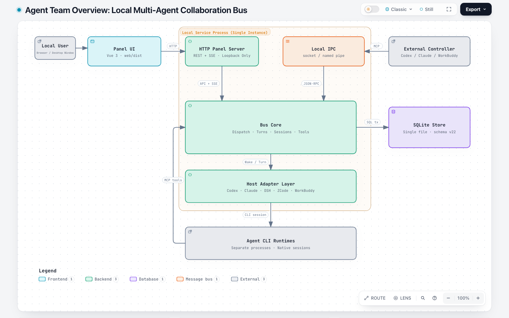
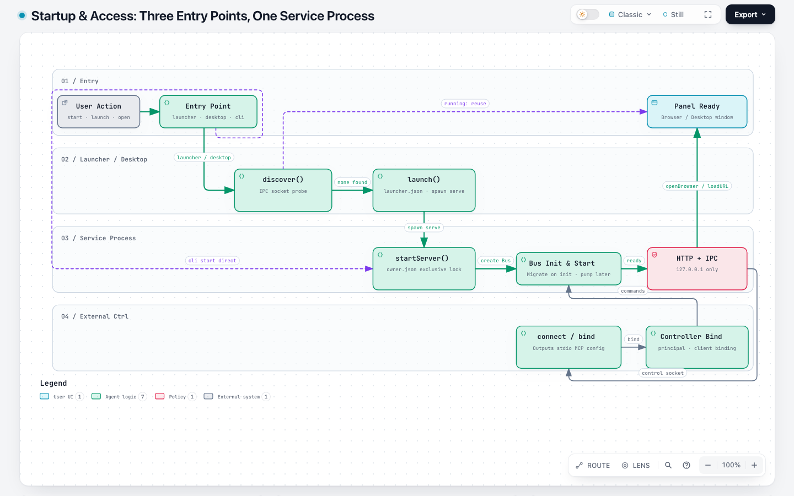
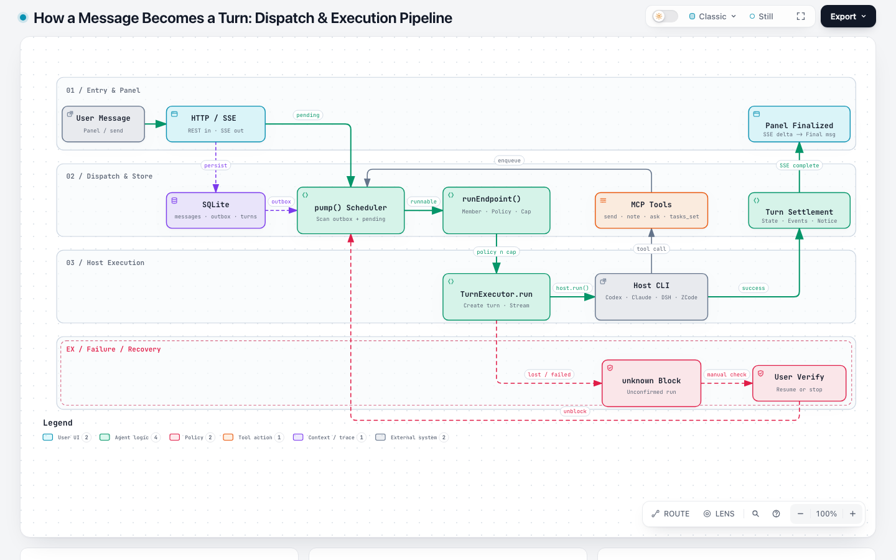
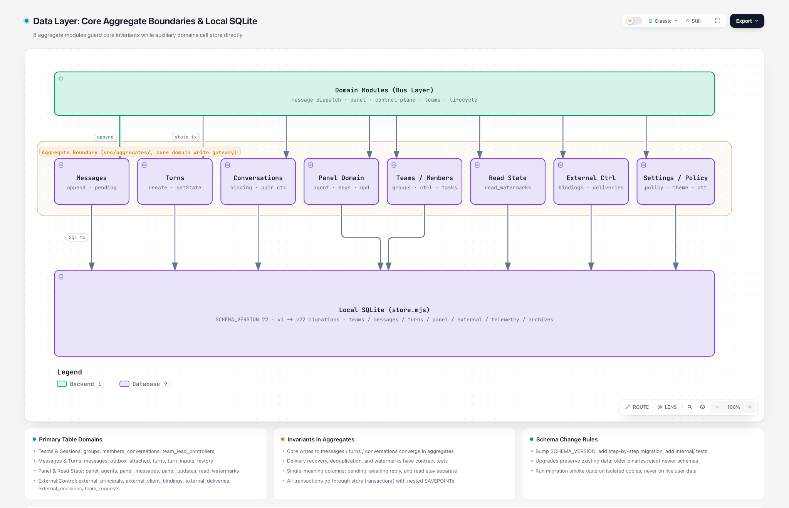
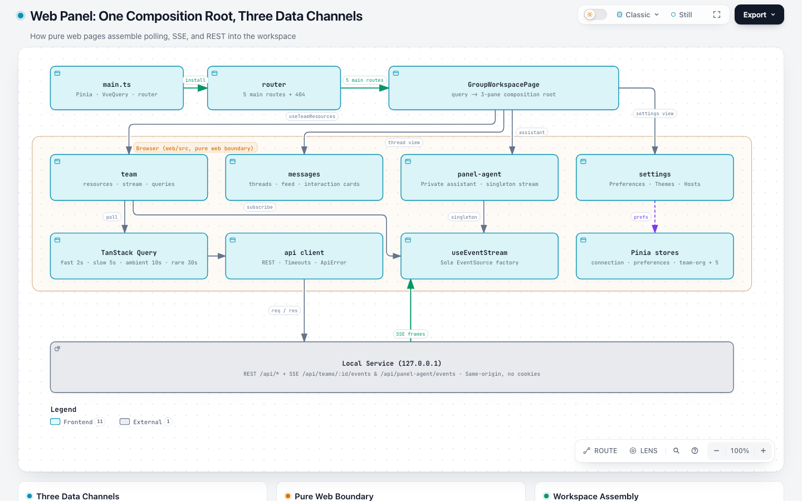

# Architecture & Communication

[Back to README](../../README.en.md) · [简体中文](../architecture.md) · [Glossary](../../GLOSSARY.md) · [Host Adapters](host-adapters.md)

## Local B/S & Overall Boundaries

The browser and Electron desktop window share the same `web/dist` frontend; the Node ESM service handles the local message bus, turn scheduling, HTTP API, and host integration; SQLite stores framework records. The panel binds strictly to `127.0.0.1`, and production UI assets are served same-origin with `/api/*`. The CLI and External controllers communicate over local IPC (Unix socket or Windows named pipe).

<picture>
  <source media="(prefers-color-scheme: dark)" srcset="../../assets/architecture/en/overview-dark.png">
  
</picture>

- Program binaries and user data stay separate. Model authentication and execution run inside independent host CLI subprocesses rather than inside the service process memory; host calls may reach external model providers, so "local" does not mean fully offline.
- ZCode is a built-in CLI bundled with the ZCode desktop app; WorkBuddy is an external MCP controller that never spawns as a team member. Agent Team's own Electron desktop window is only a first-party panel entry point (`loadURL(instance.url)`), not a model host.

## Startup, Single-Instance & Three Entry Points

<picture>
  <source media="(prefers-color-scheme: dark)" srcset="../../assets/architecture/en/entry-dark.png">
  
</picture>

- **Two startup paths**: [launcher.mjs](../../src/launcher.mjs) and the desktop shell ([electron/service.mjs](../../electron/service.mjs)) call `discover()` to probe the IPC socket first—reusing any running instance, or calling `launch()` to read/remember the port preference in `launcher.json` and spawn `cli.mjs serve` (logging to `service.log`). Running `cli.mjs start` or `serve` directly bypasses `discover()` and invokes `startServer()`.
- **Single-instance lock**: `launcher.json` stores only a port preference; the authoritative lock is `owner.json` inside the data directory (created exclusively with `O_EXCL`, with PID liveness checks to clean stale crash locks). Stopping the service uses `launcher --stop` (sending `service_stop` and waiting for `owner.json` removal); `cli.mjs stop` stops an individual team member.
- **Startup order & security boundaries**: `new Bus()` runs SQLite schema migrations before IPC and HTTP begin listening; `bus.start()` then runs after listening starts to recover unfinished outputs, start maintenance timers, and run the first `pump()`. HTTP checks `127.0.0.1`/`localhost` Host headers, blocks cross-site and cross-origin write requests, and enforces CSP (`default-src 'self'`). Desktop windows allow loading `127.0.0.1` only. Archived teams return `410` on HTTP routes (except restore, delete, and archive-snapshot endpoints).

## Sessions, Messages & Dispatch Pipeline

<picture>
  <source media="(prefers-color-scheme: dark)" srcset="../../assets/architecture/en/pipeline-dark.png">
  
</picture>

- Each team has one Main Agent coordination session. All formal member reports to the Main Agent arrive here serially; inputs arriving while busy are coalesced in order.
- Peer members communicate in isolated pair conversations (`pair:<sender>`); different pairs run in parallel instead of merging everyone's messages into one giant context.
- `send(to, text)` persists immediately and triggers `pump()` to wake the recipient; `note(to, text)` does not wake and batches onto the next formal input. `expects_reply` and `reply_to` link replies back to the original request.
- `pump()` scans `outbox` and pending messages, skipping archived teams, `unknown`-blocked scopes, and conversations with an active `running` turn. `runEndpoint()` checks member, conversation, policy, and capabilities (explicitly rejecting unsupported requested policies without silent downgrade), then `TurnExecutor.run` creates a turn, calls `host.run()`, and streams events to the panel.
- `read` paginates team history, `members` inspects roster entries, `profile_set` updates only the caller's self-profile, and `tasks_set` / `group_tasks_set` update task lists.
- `ask` emits an interaction card and returns immediately. The member ends its current turn, and a new turn starts once the user answers.
- Members should end their turn when waiting for new messages so the framework can wake them again; host-native child-agent and blocking wait tools are trimmed.
- Turn settlement writes terminal states, publishes controller output via `teamDirectives`, and triggers `pump()` to drain queued work. Delivery failures record errors and system notices without auto-retry.

The framework handles message routing, turn scheduling, delivery safety, and host integration. Role division, review thoroughness, and deliverable acceptance are organized through agent messages and user judgment—there is no hard-coded business workflow.

## Headless External Controllers

External hosts attach over a fixed stdio MCP shim to the local daemon. One external principal can hold multiple client bindings and manage multiple teams, while each team has at most one active controller session at a time.

An External controller is neither a Member nor the Panel Agent. Team messages sent by it attribute `sender` to the principal; member replies enqueue into `external_deliveries` for the controller to claim via `control_inbox`. Member `ask` calls in headless teams write `external_decisions`, and controller answers return as user-origin messages to the requesting member.

External controller capabilities come from the intersection of adapter declarations and connection-time measurements (whereas member host capabilities are declared statically at build time without runtime probing). Becoming a controller requires stable session identity, message delivery, runtime status, and turn terminal-state observation. Effective team permissions never exceed the intersection of the controller's host permissions, registered workspace, team policy, and member host capabilities.

See [Headless Control Plane](headless-control-plane.md).

## Panel Agent & Teams

The Panel Agent is a global private session that can observe shared records across teams while staying separate from each team's coordination session. Requests initiated in private chat are handed off via `team_request_submit`, and teams reply with source-referenced receipts via `team_receipt_publish`. Direct team messages are not automatically copied into private history, and team-source notifications do not automatically trigger a private model turn.

Users can approve taking over or handing back Main Agent coordination via interaction cards. Takeover changes the controller relationship without expanding file permissions.

## Permissions & Recovery

Team execution policies are `communication | read-only | workspace-write`. Private sessions support `read-only`, `workspace-write`, and `full-access`; team coordination sessions remain coordination-only and do not read or write project files. Logical domains separate `communication` and `project`, mapped to physical sessions by each adapter: Codex splits communication and project into distinct threads, while Claude, DSH, and ZCode reuse sessions. Every turn records both requested policy and resolved configuration.

The service preserves four key guarantees:

1. Uncertain executions are marked `unknown` and block further delivery until verified by the user—never auto-replayed.
2. User directives carry durable request keys to prevent duplicate dispatch on network retries; page team creation and initial directives are separately idempotent.
3. Stopping the service preserves teams, configurations, and saved messages with restart recovery semantics.
4. When a host does not support the requested policy, the turn is rejected rather than silently downgrading permissions or switching models.

Teams have only two states: `open` and `archived`. Archiving pauses delivery and can be restored anytime; it does not imply work acceptance.

Archiving captures a static factual snapshot (charter, member task lists, existing messages, and interactions) without invoking a model. When viewed in Settings, the Panel Agent generates and caches a summary in an isolated `archive-summary` session under `communication` policy with no tools, keeping private chat clean. Snapshot data survives history retention pruning; restoring a team deletes the snapshot/summary and cancels generation, while re-archiving creates a fresh snapshot. Legacy archived teams without snapshots gain them after restoring and re-archiving. Only message references are stored—artifacts are not copied.

## Data Storage & Aggregate Boundaries

<picture>
  <source media="(prefers-color-scheme: dark)" srcset="../../assets/architecture/en/data-dark.png">
  
</picture>

- **Single-file SQLite (`SCHEMA_VERSION = 24`)**: [store.mjs](../../src/store.mjs) manages step-by-step `v1 → v24` migrations; older binaries reject newer schemas. `store.transaction()` natively supports nesting via `SAVEPOINT`.
- **8 aggregate boundaries ([src/aggregates/](../../src/aggregates/))**: `messages`, `turns`, `conversations`, `panel`, `teams`, `read-state`, `external-control`, and `settings` enforce core invariants (core writes to `messages` / `turns` / `conversations` converge in aggregates; pending delivery, awaiting reply, and read watermarks keep distinct non-overloaded fields). Auxiliary domains (telemetry, attachments, notes, archive snapshots) and read queries may call `store` directly.
- **Primary table domains**: Teams & sessions (`groups`, `members`, `conversations`, `team_lead_controllers`), messages & turns (`messages`, `outbox`, `attached`, `turns`, `turn_inputs`, `history`), panel & read state (`panel_agents`, `panel_messages`, `panel_updates`, `read_watermarks`), and external control (`external_principals`, `external_client_bindings`, `external_deliveries`, `external_decisions`, `team_requests`).

## Web Panel & Local Endpoints

<picture>
  <source media="(prefers-color-scheme: dark)" srcset="../../assets/architecture/en/web-dark.png">
  
</picture>

- **Single composition root & pure-web boundary**: [GroupWorkspacePage.vue](../../web/src/pages/GroupWorkspacePage.vue) assembles the left team sidebar, center conversation feed, and right context inspector. Five main routes (`/agent`, `/groups/new`, `/groups/:groupId?`, `/notes`, `/settings`) mount it and switch views mutually exclusively via `v-if` inside `<main>` (with [NotFoundPage.vue](../../web/src/pages/NotFoundPage.vue) for unknown paths). `web/src` never imports Electron APIs directly; native desktop helpers inject optionally through `globalThis.agentTeam?.xxx` with HTTP fallbacks.
- **Three data channels**:
  - **TanStack Query ([queries.ts](../../web/src/features/queries.ts))**: Four polling tiers—`fast` (2s), `slow` (5s), `ambient` (10s), and `rare` (30s);
  - **SSE ([use-event-stream.ts](../../web/src/features/streams/use-event-stream.ts))**: Sole `EventSource` construction site across the frontend, serving both team streams (`/api/teams/:id/events`) and the Panel Agent stream (`/api/panel-agent/events`) with ordered frame batching and full snapshot recovery on reconnect; event views show only what adapters observed;
  - **REST ([client.ts](../../web/src/shared/api/client.ts))**: Same-origin requests without cookies, separate read/write timeout budgets, and 8 Pinia stores (`connection`, `preferences`, `team-organization`, `ui`, etc.) for frontend state and local preferences.

HTTP endpoints enforce Host, cross-site, method, and loopback checks, plus Origin checks on write requests. The default local panel uses no login accounts or cookies and must not be exposed directly as a public network service.

## Implementation Map

| Area | Entry Points |
| --- | --- |
| Startup, Server & IPC | [launcher.mjs](../../src/launcher.mjs), [server.mjs](../../src/server.mjs), [rpc.mjs](../../src/rpc.mjs) |
| Messages, Turns & Dispatch | [bus.mjs](../../src/bus.mjs), [message-dispatch.mjs](../../src/message-dispatch.mjs), [turn-executor.mjs](../../src/turn-executor.mjs) |
| Bus Collaborators | [bus/model-catalog.mjs](../../src/bus/model-catalog.mjs) (model catalog probes), [bus/app-settings.mjs](../../src/bus/app-settings.mjs) (policy presets / themes / attachment settings), [bus/maintenance.mjs](../../src/bus/maintenance.mjs) (retention timers) |
| Tool Surface | [tools/registry.mjs](../../src/tools/registry.mjs), [tools/dispatch.mjs](../../src/tools/dispatch.mjs), [tools/ops.mjs](../../src/tools/ops.mjs), [tools/schema.mjs](../../src/tools/schema.mjs), [tools/panel.mjs](../../src/tools/panel.mjs) |
| HTTP Boundary | [http/routes.mjs](../../src/http/routes.mjs), [http/access.mjs](../../src/http/access.mjs), [http/directory.mjs](../../src/http/directory.mjs), [http/files.mjs](../../src/http/files.mjs) |
| Hosts & Adapters | [hosts/](../../src/hosts/), [host-runtime/](../../src/host-runtime/), [member/](../../src/member/) |
| External Control & Capabilities | [control-plane.mjs](../../src/control-plane.mjs), [control-capabilities.mjs](../../src/control-capabilities.mjs) |
| Storage & Aggregates | [store.mjs](../../src/store.mjs), [aggregates/](../../src/aggregates/), [archive-snapshots.mjs](../../src/archive-snapshots.mjs) |
| Panel Sessions, Requests & Lifecycle | [panel-sessions.mjs](../../src/panel-sessions.mjs), [team-requests.mjs](../../src/team-requests.mjs), [group-lifecycle.mjs](../../src/group-lifecycle.mjs) |
| Notes & Prompts | [notes.mjs](../../src/notes.mjs), [notes-prompt.mjs](../../src/notes-prompt.mjs) |
| Frontend & Desktop Shell | [GroupWorkspacePage.vue](../../web/src/pages/GroupWorkspacePage.vue), [electron/main.mjs](../../electron/main.mjs), [docs/DESIGN.md](../../docs/DESIGN.md) |

`src/bus.mjs` acts as a **facade**, delegating implementations to `src/bus/` (mirroring `panel-sessions.mjs` + `panel/` and `telemetry.mjs` + `telemetry/`). Roughly 95 one-line forwarding methods keep over a thousand `bus.xxx(` call sites insulated from collaborator refactors; new logic should land in collaborators with only a matching one-line forwarder on the facade.

Team deletion goes through `GroupLifecycle.deleteGroup`: an in-memory mutex blocks new turns on that team, waits for active turns to settle, and clears database rows transactionally (including coordination messages without foreign keys, workbench dismissals, and telemetry session generations). Panel private messages are preserved with team references cleared; archive snapshots and summaries cascade-delete with the team, while project workspaces and host-native histories remain untouched. Permanent deletion in the panel accepts archived teams only (legacy CLI/Agent deletion keeps its existing scope), and post-commit cache cleanup failures return a warning rather than falsely reporting team deletion failure.
