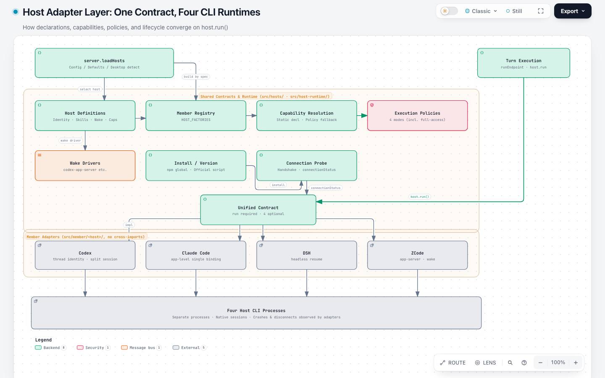

# Host Configuration & Adapters

[Back to README](../../README.en.md) · [简体中文](../host-adapters.md) · [Architecture](architecture.md) · [Limitations](limitations.md)

## Built-in Integrations

Currently four hosts can be spawned as team members, plus one desktop application registered strictly as an External controller:

| Host | Underlying Form | Allowed Roles | Active Wake |
| --- | --- | --- | --- |
| Codex | Codex CLI `app-server --stdio` | Controller, Member | Supported |
| Claude Code | Claude Code CLI | Controller, Member | Unsupported (inbox pull) |
| DSH | DSH CLI | Controller, Member | Supported |
| ZCode | CLI bundled in ZCode desktop app | Controller, Member | Supported |
| WorkBuddy | Desktop app, external MCP client | Controller only | Unsupported |

The first four are launched by member factories to hold roles and execute turns; WorkBuddy has no member factory or wake driver, so the framework cannot spawn or inject into it and only integrates via the generic MCP control channel. Codex, DSH, and ZCode register active wake drivers; Claude Code and WorkBuddy stay on persistent inbox polling.

Host registration facts converge per host in [definitions.mjs](../../src/hosts/definitions.mjs): member factory, capabilities, telemetry declarations, active wake driver, skill directory, and controller session discovery are declared in one place and derived into each registry. `session.spawn` is derived from whether a member factory exists, and `session.wake` from whether a wake driver exists. Hosts own accounts, auth, model provider settings, and quotas; the framework provides team communication tools, turn context, and requested policies without managing host credentials.

Pass `--hosts /path/hosts.json` to configure aliases, for example:

```json
{
  "hosts": {
    "codex": { "adapter": "codex" },
    "zcode": { "adapter": "zcode" },
    "writer": { "adapter": "claude" },
    "dsh": { "adapter": "dsh" }
  }
}
```

Aliases are the host names chosen by team members. `command` can specify an absolute CLI path; Codex, Claude Code, and ZCode accept `model` and `reasoningEffort` overrides per call without altering host account settings. Selected models must exist in the available catalog; models are never silently swapped, and omitting reasoning effort keeps host defaults.

WorkBuddy is not a spawnable member and does not belong in this member-hosts config; register it as an External controller via `agent-team connect --host workbuddy`.

## Layering & Unified Contract

<picture>
  <source media="(prefers-color-scheme: dark)" srcset="../../assets/architecture/en/hosts-dark.png">
  
</picture>

The host subsystem is split into three layers with strict boundaries:

- **[src/hosts/](../../src/hosts/) (definitions, capabilities, policies, contract)**: `definitions.mjs` centralizes host declarations; `index.mjs` builds `HOST_FACTORIES` and `assertHostContract` (requiring `run`, plus optional `connectionStatus`, `sessionKey`, `supportsPolicy`, and `capabilities` functions); `policies.mjs` translates `communication | read-only | workspace-write | full-access` into host flags; `capabilities.mjs` and `execution.mjs` **perform no runtime capability probing**—member capabilities are declared statically at development time and combined with team policy, shell flags, and OS boundaries (e.g., Codex falls back to `communication` when shell is disabled, `read-only` keeps read-only shell, and unsupported requested policies fail the turn).
- **[src/host-runtime/](../../src/host-runtime/) (shared runtime helpers)**: Implements install/version checks (`lifecycle.mjs`), protocol handshake probes (`probe.mjs`), subprocess management (`subprocess.mjs`), and external wake driver registration (`wake-drivers.mjs`). `connectionProbe` checks CLI availability and handshake status only—it does not modify static member capabilities.
- **[src/member/](../../src/member/) (four isolated member adapters)**: `codex/`, `claude/`, `dsh/`, and `zcode/` live in separate directories with zero cross-imports. Codex splits `communication` and `project` into separate thread domains; Claude Code uses a single app-level connection with no wake driver; DSH uses headless resume; ZCode uses `app-server`. Skill directories use copied directories for Codex, Claude, and WorkBuddy, and a shared directory for DSH and ZCode.

> Distinguish the two capability models: **member hosts** do no runtime capability probing ([capabilities.mjs](../../src/hosts/capabilities.mjs)), whereas **External controllers** require the intersection of adapter declarations and connection-time probes ([control-capabilities.mjs](../../src/control-capabilities.mjs)).

## Install Checks & Connection Probes

| Method | Question Answered |
| --- | --- |
| `checkStatus()` | Whether an installed, runnable command was found (also used by install flows) |
| `probeConnection()` | Whether the adapter protocol can communicate with the host (drives available / unavailable / missing UI state) |
| `connectionStatus()` | Latest probe result or in-progress status |
| `cancelProbe()` | Cancels and cleans up probe child processes owned by the adapter |
| `listModels({ signal })` | Returns normalized model catalog entries with caching |

Probes never send model prompts. Codex initializes `app-server` and reads its catalog; Claude runs its control init handshake; DSH uses a temporary overlay with task executors explicitly disabled; ZCode runs `app-server` startup handshake and lists sessions. Timeouts, cancellation, output caps, and cleanup live in [probe.mjs](../../src/host-runtime/probe.mjs).

Protocols depend on host versions. A passing probe does not prove account quota, online inference, or that the next turn will succeed; runtime host errors are surfaced to the user without auto-login, config edits, or silent business-message replay.

## ZCode Desktop App Launch & Layout Compatibility

ZCode controller wake, member execution, and model catalog probes all speak `zcode.cjs app-server --stdio` (ZCode Protocol in [zcode/protocol.mjs](../../src/member/zcode/protocol.mjs), launch resolution in `resolveZcodeLaunch` inside [zcode/wake.mjs](../../src/member/zcode/wake.mjs)). Desktop app updates change the embedded CLI's directory layout and Electron restrictions, which the adapter handles automatically:

- **Layout detection**: `detectZcodeLayout(appRoot)` distinguishes older `Resources/glm/provider/` from newer `Resources/config/provider/` layouts.
- **Legacy layout**: Launches with the Electron binary + `ELECTRON_RUN_AS_NODE=1`.
- **New layout**: `prepareZcodeEntry(appRoot)` copies the entry `.cjs` and provider config into a stable hash-named temp directory, symlinks `node-runtime`, and runs via **system Node**—bypassing Electron's "invoked by other apps" restriction while letting `.cjs` find its config at the relative path it expects. Existing directories are skipped idempotently; `AGENT_TEAM_ZCODE_COMPAT_DIR` overrides this path for tests.

Troubleshooting notes:

- Errors citing missing built-in provider config or session model outside Provider Registry point to layout detection mismatches between `zcode-builtin.json` and `detectZcodeLayout`.
- `Node.js environment variables are disabled because this process is invoked by other apps` reflects Electron's launch restriction handled by the system-Node wrapper branch.
- **Isolated data directories**: Redirecting `HOME` in tests requires at least `~/.zcode/v2/provider_config.json` (provider definitions, credentials, default model) or `session/create` will fail.
- **Unified launch override**: `AGENT_TEAM_ZCODE_COMMAND` (or `ZCODE_AGENT_SERVER_COMMAND`) overrides the launch command across member, wake, and catalog probe paths.
- **Outer harness `NODE_OPTIONS`**: Verification scripts spawned from hosts that inject file-access shims via `NODE_OPTIONS` may clear it for their own child processes.

Reference script: [verify-zcode-host.mjs](../../scripts/verify-zcode-host.mjs) (uses hardcoded host app paths and should be updated per machine/version; verify handshake first before spending model quota).

## DSH Model Discovery & API Key Injection

DSH discovers models through a headless profile catalog probe ([dsh/model-catalog.mjs](../../src/member/dsh/model-catalog.mjs)). Because headless one-shot turns disable the credential service, discovery relies on `DEEPSEEK_API_KEY`; without it, `llm.listModels()` returns empty arrays and member turns also fail.

[dsh/credentials.mjs](../../src/member/dsh/credentials.mjs) reads `~/.dsh/.credentials.yaml` locally before spawning DSH subprocesses whenever `DEEPSEEK_API_KEY` is unset (preserving existing env vars and never printing secrets). Both catalog probes and member turns use this path. **Because the running service loads code at startup, restart the service after upgrading.**

## Writing a New Adapter

Configure `{ "module": "/absolute/path/adapter.mjs" }` exporting `createHost(options)` returning an object with `run(context)`. Reference built-in adapters rather than concatenating final strings only.

Adapters should handle:

- Session creation/resume, distinguishing input acceptance from turn completion.
- Streaming text, tool calls, errors, cancellation, process-tree cleanup, and `unknown` runtimes.
- Requested policy checks and recording resolved host config, rejecting unsupported policies explicitly.
- Optional model catalog, capabilities, telemetry reporting, and independent connection probes.
- Optional `executionCapabilities`: declaring actual file read, workspace write, shell, and path-boundary capabilities under a given policy and shell toggle (never mark a member writable without path boundaries).
- Optional active wake driver: environment fingerprinting and live session injection; hosts without one stay explicitly pull-only.

Key files: [definitions.mjs](../../src/hosts/definitions.mjs), [codex/index.mjs](../../src/member/codex/index.mjs), [codex/wake.mjs](../../src/member/codex/wake.mjs), [dsh/index.mjs](../../src/member/dsh/index.mjs), [dsh/wake.mjs](../../src/member/dsh/wake.mjs), [zcode/index.mjs](../../src/member/zcode/index.mjs), [zcode/wake.mjs](../../src/member/zcode/wake.mjs), [zcode/protocol.mjs](../../src/member/zcode/protocol.mjs), [wake-drivers.mjs](../../src/host-runtime/wake-drivers.mjs), [subprocess.mjs](../../src/host-runtime/subprocess.mjs), [catalog.mjs](../../src/hosts/catalog.mjs), [policies.mjs](../../src/hosts/policies.mjs).

Model catalogs can be queried via CLI; global model policies in Settings supply defaults for newly created roles without retroactively rewriting existing members. Event views reflect only what the adapter observed, not the host's full native transcript.
