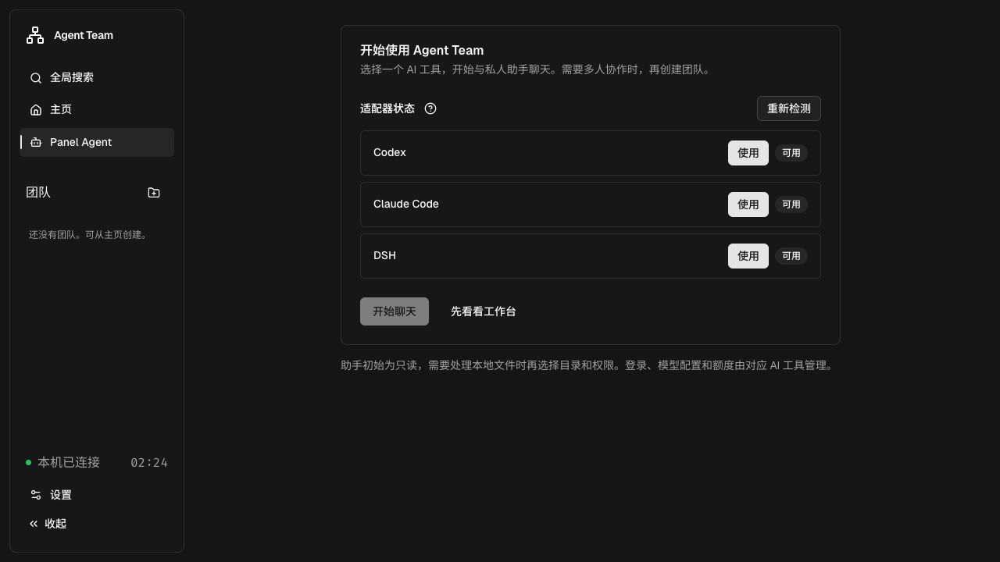

# Quick Start

[Back to README](../../README.en.md) · [简体中文](../quick-start.md) · [User Guide](user-guide.md) · [Limitations](limitations.md)

## Prepare an AI Tool

Current source supports Codex, Claude Code, DSH, or ZCode installed locally as team members. Install at least one tool and complete its own login, model provider configuration, and quota setup—you do not need all four. WorkBuddy can attach as an External MCP controller, not as a spawned team member.

The v0.5.0 release packages predate ZCode member support and WorkBuddy controller registration; use current source (or a newer release) for those hosts. See [Host Configuration & Adapters](host-adapters.md) for host differences.

Agent Team provides team communication and coordination around these tools without managing their accounts. "Available" means the adapter can talk to the host CLI—not a guarantee that the next model turn or quota check will succeed. Probes do not send model prompts.

## Launch Options

The project is converging from the browser UI to a desktop window. Both entry points share the same panel and data directory—switching between them preserves chat history.

### Desktop Window (Development)

Requires Node.js >=22.13 and the source repository (see [Development & Build](development.md)):

```bash
npm ci
npm run desktop
```

Closing the window hides it to the system tray while keeping the service running; use the tray menu to stop the service, open in browser, or quit the desktop window. The first run downloads the Electron binary. This is the recommended way to run from source, though standalone desktop release installers are not packaged yet.

### Release Packages (Browser UI)

Download the archive for your OS from [Releases](https://github.com/AlbertZhou1108/agent-team/releases). v0.5.0 provides **macOS Apple Silicon (arm64)**, **Windows x64**, and **Linux x64** packages with SHA-256 checksums:

1. Extract the archive.
2. Open the launcher entry: `Agent Team.app` on macOS, `.cmd` on Windows, or `.sh` on Linux. It starts the local service and opens the browser.
3. During onboarding, pick an available tool and click Use.
4. Keep the default model or expand model/name customization, then start chatting.

Release packages bundle Node and prebuilt frontend assets. They are unsigned and unnotarized, so OS security prompts must be approved manually. v0.5.0 upgrades the data schema to v18—stop any running service before upgrading; older versions cannot open newer schemas.



*First-run onboarding (Chinese UI screenshot).*

## Start Your First Conversation

Use the private assistant (Panel Agent) for consultation, scoping, or observing existing teams. Try a prompt such as:

> Help me plan a 90-minute community reading club for 15 people with a 300 RMB budget.

You can also click an example prompt to populate and edit a draft. Initial access is `read-only`; select a private workspace and access policy in assistant settings when local file work is needed.

## Create a Multi-Agent Team

Click Create Team from the workbench or private chat, enter your brief, workspace folder, members, and access policy, then submit. The form configures a Main Agent and a collaborating member; more complex rosters can be organized by the Panel Agent or via the [CLI](cli.md).

New members call their model once for a self-profile, and subsequent chat, collaboration, and summaries consume host quota as usual. If an initial directive is not confirmed delivered, use the retry button on that page instead of creating a duplicate team.

## Headless Integration from an Existing Agent

If you prefer driving teams from an active Codex, Claude Code, DSH, ZCode, WorkBuddy, or other MCP-compatible agent session, register an External controller binding first:

```bash
npm start -- connect --data /your/framework-data-dir \
  --host codex --client codex-main --principal local-user \
  --workspace /allowed/project-root
```

Add the printed `mcp.agent_team` config to your host's MCP settings and have the host read `skills/agent-team/`. New sessions should call `control_protocol` first, then `control_teams`, `team_create`, and `team_send`. Member replies queue in persistent `control_inbox` without requiring the panel UI—see [Headless Control Plane](headless-control-plane.md).

Known hosts install/update the Skill automatically; other hosts can pass `--skill-root` or `--no-install-skill`. Top-level Codex sessions auto-bind their thread and wake idle deliveries via `exec resume` re-injecting Agent Team MCP; Codex multi-agent child sessions stay pull-only.

## Stopping, Resuming & Upgrading

- **Closing the desktop window or browser tab**: The service and active work continue running. Closing the desktop window hides it to the tray; launching again reuses the running service.
- **Stopping the service**: Use the tray menu on desktop, Settings -> General -> Stop Local Service in the browser, or the stop script in the release directory. Active turns are interrupted while records are preserved.
- **Resuming later**: Configured assistants persist across restarts; past private chat turns appear under History, and team threads remain on team pages.
- **Upgrading**: Stop the service before replacing binaries while keeping your data directory (back it up while stopped). Downgrading to older versions across schema bumps is not supported.

| OS | Default Framework Data Directory |
| --- | --- |
| macOS | `~/Library/Application Support/Agent Team` |
| Windows | `%LOCALAPPDATA%/Agent Team` |
| Linux | `$XDG_DATA_HOME/agent-team` (fallback `~/.local/share/agent-team`) |

The framework data directory, private workspace, and team workspace serve distinct purposes. Development CLI data under `work/local` is not migrated automatically to the application data directory.
