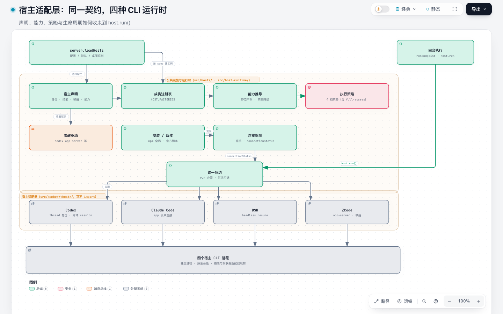

# 宿主配置与适配

[返回产品介绍](../README.md) · [架构](architecture.md) · [限制](limitations.md)

## 内置接入

当前有四个可启动的成员宿主，另有一个仅作为外部主控登记的桌面应用：

| 宿主 | 实际形态 | 可用角色 | 主动唤醒 |
| --- | --- | --- | --- |
| Codex | Codex CLI 的 `app-server --stdio` | 主控、成员 | 支持 |
| Claude Code | Claude Code CLI | 主控、成员 | 不支持，保持收件箱拉取 |
| DSH | DSH CLI | 主控、成员 | 支持 |
| ZCode | ZCode 桌面应用内置 CLI | 主控、成员 | 支持 |
| WorkBuddy | 桌面应用，外部 MCP 客户端 | 仅主控 | 不支持 |

前四者由成员工厂启动，能在群中担任角色并执行回合；WorkBuddy 没有成员工厂和唤醒驱动，框架不能启动或注入它，只能通过通用 MCP 主控通道参与。Codex、DSH、ZCode 注册了主动唤醒驱动；Claude Code 与 WorkBuddy 目前保持持久收件箱拉取。

宿主的注册事实按宿主收敛在 [definitions.mjs](../src/hosts/definitions.mjs)：成员工厂、能力、遥测声明、主动唤醒驱动、技能目录与主控会话发现一处声明，各注册表从它派生。`session.spawn` 由是否存在成员工厂推导，`session.wake` 由是否存在唤醒驱动推导。宿主负责账号、认证、模型服务配置与额度；框架提供团队通信工具、回合上下文和请求策略，不代配宿主。

通过 `--hosts /路径/hosts.json` 指定框架配置，例如：

```json
{
  "hosts": {
    "codex": { "adapter": "codex" },
    "zcode": { "adapter": "zcode" },
    "writer": { "adapter": "claude" },
    "dsh": { "adapter": "dsh" }
  }
}
```

别名是团队成员选择的宿主名称。`command` 可指定 CLI 绝对路径；Codex、Claude Code、ZCode 可设置框架调用所用的 `model` 与 `reasoningEffort`。这些调用参数不是修改宿主账号配置。模型选择必须来自可用目录；不静默切换模型。没有覆盖思考强度时保留宿主行为。

WorkBuddy 不属于可启动成员，因此不写入这份成员宿主配置；使用 `agent-team connect --host workbuddy` 登记外部主控连接。

## 架构分层与契约收束

<picture>
  <source media="(prefers-color-scheme: dark)" srcset="../assets/architecture/hosts-dark.png">
  
</picture>

宿主体系按职责拆为三层，各自遵守清晰边界：

- **[src/hosts/](../src/hosts/)（定义、能力、策略与契约）**：`definitions.mjs` 统一收敛宿主声明；`index.mjs` 构建 `HOST_FACTORIES` 与 `assertHostContract`（校验 `run` 必需及 `connectionStatus` / `sessionKey` / `supportsPolicy` / `capabilities` 四个可选函数）；`policies.mjs` 转换 `communication | read-only | workspace-write | full-access` 四档策略；`capabilities.mjs` 与 `execution.mjs` **在运行时不做能力探测**——成员能力以开发期静态声明为准，再按群策略、shell 开关和平台边界推导（例如 Codex 拿不到 shell 时降级为 `communication`，`read-only` 保留只读 shell，不支持请求策略时直接拒绝回合）。
- **[src/host-runtime/](../src/host-runtime/)（运行时公共设施）**：集中实现安装/版本检查（`lifecycle.mjs`）、通信握手探测（`probe.mjs`）、子进程管理（`subprocess.mjs`）和外部主控唤醒驱动注册（`wake-drivers.mjs`）。其中 `connectionProbe` 只检测 CLI 可用性与协议握手，不回改成员静态能力。
- **[src/member/](../src/member/)（四家成员适配器）**：`codex/`、`claude/`、`dsh/`、`zcode/` 各自独立目录、互不 `import`。Codex 按 `communication` / `project` 分两个 thread 域；Claude Code 为 app 级单连接且无唤醒驱动；DSH 走 headless resume；ZCode 走 `app-server`。技能目录按宿主定义分别采用复制（Codex / Claude / WorkBuddy）或共享目录（DSH / ZCode）。

> 注意区分两类能力模型：**成员宿主**运行时不做能力探测（[capabilities.mjs](../src/hosts/capabilities.mjs)），而**外部主控**的接管能力才要求「适配器声明 ∩ 连接时实测」（[control-capabilities.mjs](../src/control-capabilities.mjs)）。

## 安装检查与通信检测

| 接口 | 回答的问题 |
| --- | --- |
| `checkStatus()` | 是否发现已安装、可启动的命令；安装流程仍使用这一语义 |
| `probeConnection()` | 能否通过适配器协议与宿主通信；页面据此显示可用、不可用或未安装 |
| `connectionStatus()` | 最近一次通信检测结果或检测中状态 |
| `cancelProbe()` | 取消并收尾适配器拥有的检测进程 |
| `listModels({ signal })` | 返回规范化模型目录，支持按宿主获取与缓存 |

检测不发送模型消息。Codex 使用 app-server 初始化及目录；Claude 使用控制初始化协议；DSH 使用临时 overlay，并显式禁用任务执行器后读取目录；ZCode 完成 app-server 启动握手并列出会话。进程超时、取消、输出上限与清理集中在 [probe.mjs](../src/host-runtime/probe.mjs)。

协议与宿主版本相关。检测成功不证明账号额度、线上推理或下一回合一定成功；实际宿主错误仍会反馈给用户，不自动登录、修改配置或重放业务消息。

## ZCode 桌面 app 的启动与版本适配

ZCode 的主控唤醒、成员执行与模型目录探测都经 `zcode.cjs app-server --stdio`（ZCode Protocol），协议层见 [zcode/protocol.mjs](../src/member/zcode/protocol.mjs)，启动命令解析见 [zcode/wake.mjs](../src/member/zcode/wake.mjs) 的 `resolveZcodeLaunch`。桌面 app 随版本升级会改变内置 CLI 的启动约束与目录布局，产品代码已内置兼容，新旧版本都可用：

- **布局探测**：`detectZcodeLayout(appRoot)` 按 provider 配置位置区分两版——旧版配置在入口旁 `Resources/glm/provider/`，新版迁到 `Resources/config/provider/`。`resolveZcodeLaunch` 据此选择启动方式。
- **旧版**：保持原样，以 Electron 二进制 + `ELECTRON_RUN_AS_NODE=1` 执行入口。
- **新版**：`prepareZcodeEntry(appRoot)` 把入口 cjs 与 provider 配置复制到按 appRoot 哈希命名的稳定临时目录、软链 `node-runtime`，改用**系统 Node** 直接执行入口。这样既绕开 Electron「invoked by other apps」限制，又让 cjs 按旧路径找到已迁移的配置。目录稳定且「存在即跳过」，多次唤醒幂等；`AGENT_TEAM_ZCODE_COMPAT_DIR` 可重定向该目录（测试用）。

排查相关报错时：

- 「无法定位 CLI ZCode Built-in Provider Config」/「当前 Session Model 不属于 Provider Registry」指向配置布局，核对 app 内 `zcode-builtin.json` 的实际位置与 `detectZcodeLayout` 的判定。
- 「Node.js environment variables are disabled because this process is invoked by other apps」是 Electron 启动约束，新版分支已改用系统 Node 绕开。
- **隔离数据目录**：把数据目录重定向到隔离 HOME 时，需带最小配置层（至少 `~/.zcode/v2/provider_config.json`，含 provider 定义、凭据与默认模型选择），否则会话模型不在 Provider Registry、`session/create` 会失败。验收脚本负责为各隔离 HOME 补齐；常规探测用真实 HOME，不受影响。
- **统一启动出口**：`AGENT_TEAM_ZCODE_COMMAND`（或 `ZCODE_AGENT_SERVER_COMMAND`）可覆盖启动命令，`resolveZcodeLaunch` 的成员、唤醒、目录探测三条路径都读它，优先级高于内置布局探测。
- **外围环境注入**：若脚本跑在注入了文件访问 shim 的外围宿主里，`NODE_OPTIONS` 会透传给子进程、拦截本机配置读取。验收类脚本可检测并清除该注入项（仅影响自身派生子进程）。

可运行的完整参考是 [verify-zcode-host.mjs](../scripts/verify-zcode-host.mjs)：它在隔离临时目录内复制入口 cjs、迁移 provider 配置、用系统 Node 包装启动，并通过 `AGENT_TEAM_ZCODE_COMMAND` 让主控会话与成员宿主走同一出口；替换启动命令的适配集中在 `prepareZcodeLaunch()`。该脚本对宿主 app 是硬编码绝对路径，换机器或换版本需同步改常量。升级后先用不消耗额度的握手探测（启动握手 → `session/create` → `session/setThoughtLevel`）验证可行，再跑完整双角色验收，避免白花模型额度。

## DSH 的模型发现与 API Key

DSH 通过 headless profile 的模型目录探针读取可用模型（[dsh/model-catalog.mjs](../src/member/dsh/model-catalog.mjs)）。headless 一次性回合禁用凭据服务，模型发现依赖环境变量 `DEEPSEEK_API_KEY`：若未注入该 key，`llm.listModels()` 对每个 provider 返回空数组，状态页显示「DSH 没有可用模型」，且真实成员回合同样受影响。

适配器通过 [dsh/credentials.mjs](../src/member/dsh/credentials.mjs) 自动处理：派生 DSH 子进程前，若环境里没有 `DEEPSEEK_API_KEY`，就从本机 `~/.dsh/.credentials.yaml` 读取并注入（已有环境变量优先，不覆盖）；文件仅本机读取、不打印内容，读取失败时保持原环境、由宿主报错。模型目录探测与成员回合两条路径都会注入。注入后目录探针可正常返回 `deepseek-flash`、`deepseek-v4-pro` 等模型。需要注意：**服务进程启动时加载的是当时代码**，升级后需重启服务才会启用自动注入。

## 新适配器

配置 `{ "module": "/绝对路径/adapter.mjs" }`，模块导出 `createHost(options)`，返回实现 `run(context)` 的对象。完整上下文与事件处理应参照内置实现，而不是只把最终字符串拼成群消息。

适配器需要处理：

- 会话创建/恢复，以及输入接受与最终完成的区别。
- 流式文本、工具调用、错误、取消、进程树收尾与不确定运行。
- 请求策略的支持判断与实际宿主配置记录，不支持时明确拒绝。
- 可选的模型目录、能力与遥测上报，以及独立通信检测。
- 可选的 `executionCapabilities`：声明指定群策略和 shell 配置下真实可用的文件读取、工作区写入、shell 与路径边界能力。未声明路径边界时不能把成员标成可写。
- 可选的主动唤醒 driver：提供环境指纹与对现有会话的真实注入能力。未注册 driver 的宿主保持显式 pull-only。

主要入口：[definitions.mjs](../src/hosts/definitions.mjs)（按宿主注册收敛）、[codex/index.mjs](../src/member/codex/index.mjs)、[codex/wake.mjs](../src/member/codex/wake.mjs)、[dsh/index.mjs](../src/member/dsh/index.mjs)、[dsh/wake.mjs](../src/member/dsh/wake.mjs)、[zcode/index.mjs](../src/member/zcode/index.mjs)、[zcode/wake.mjs](../src/member/zcode/wake.mjs)、[zcode/protocol.mjs](../src/member/zcode/protocol.mjs)、[wake-drivers.mjs](../src/host-runtime/wake-drivers.mjs)、[subprocess.mjs](../src/host-runtime/subprocess.mjs)、[catalog.mjs](../src/hosts/catalog.mjs)、[policies.mjs](../src/hosts/policies.mjs)。

模型目录可由 CLI 查询；页面设置中的全局模型策略用于新建角色的默认模型说明，不会追溯改写所有已有角色。事件视图只呈现适配器实际观察到的内容，不等同于宿主原生完整历史。
