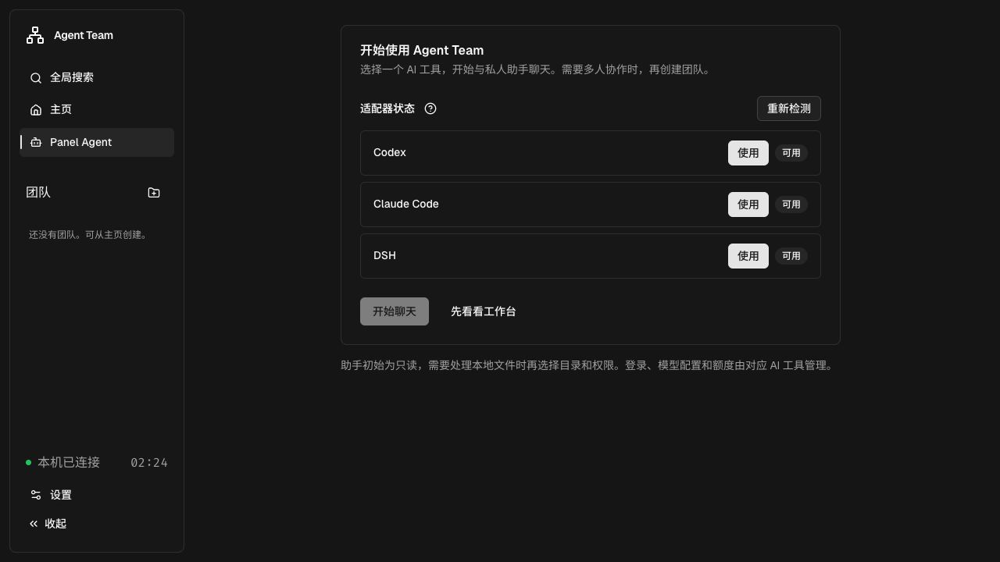

# 开始使用

[返回产品介绍](../README.md) · [日常使用](user-guide.md) · [常见限制](limitations.md)

## 准备一个 AI 工具

Agent Team 使用本机已有的 Codex、Claude Code 或 DSH。先按对应工具的说明安装，并完成它自己的登录、模型服务配置与额度准备；先接通一种即可，不必同时安装三个。

框架负责向这些工具提供团队通信和协作能力，不代管它们的账号。页面的“可用”表示当前适配器能够与宿主通信，不能保证下一次模型调用或账号额度正常。检测不会发送模型消息。

## 下载并打开

在 [Releases](https://github.com/AlbertZhou1108/agent-team/releases) 下载与你的系统匹配的包。v0.2.0 提供 **macOS Apple Silicon / arm64** 包，附 SHA-256 校验文件。Windows、Linux 当前可从源码运行，见[开发与构建](development.md)。

1. 解压下载文件。
2. 打开目录中的 `Agent Team.app`。它只启动本地服务并打开浏览器，所有操作仍在网页中完成。
3. 在首次引导中选择一个显示“可用”的工具，点击“使用”。
4. 保留明确的默认模型，或展开“调整模型与名称”选择，再点击“开始聊天”。

安装包自带框架所需的 Node 环境，使用它无需自行构建前端。v0.2.0 的 macOS 包未签名、未公证；系统的安装与安全提示仍适用，不需要关闭系统安全机制。

## 提交第一件事

私人助手适合咨询、整理需求、观察已有团队。可以先输入：

> 我想办一场 15 人的社区读书会，时长 90 分钟，预算不超过 300 元。先帮我想想怎么安排。

也可以点击示例填入草稿，编辑后再发送。初始权限为只读；需要处理本地文件时，再到助手设置中选择私人工作区和访问范围。

## 需要多人协作时

从工作台或私人聊天点击“创建团队”，填写需求、工作文件夹和成员，选择访问范围，然后创建并发送需求。表单可设置主 Agent 和一个协作助手；更复杂的成员组合可让私人助手协助组织，或通过 [CLI](cli.md) 配置。

团队成员创建时会调用模型进行能力自述，后续聊天、协作和摘要也会产生对应宿主的模型消耗。首次需求未确认送达时，使用原页面的重试入口，不必重新建群。

## 关闭、继续与升级

- **关闭网页**：服务和正在进行的工作仍会继续。再次打开启动入口，会复用已运行的服务。
- **停止服务**：设置 → 通用 → 停止本地服务，或使用发行目录的停止入口。正在进行的工作会中断，记录保留。
- **下次使用**：再次启动，已有助手不需要重新配置；私人会话此前启动的消息在“历史记录”中查看，团队记录仍在团队页面。
- **升级**：先停止服务，再替换程序；保留数据目录。停服后可以复制完整数据目录备份。旧版本降级不保证数据兼容。

| 系统 | 默认框架数据目录 |
| --- | --- |
| macOS | `~/Library/Application Support/Agent Team` |
| Windows | `%LOCALAPPDATA%/Agent Team` |
| Linux | `$XDG_DATA_HOME/agent-team`，未设置时为 `~/.local/share/agent-team` |

框架数据目录、私人工作区、团队工作文件夹是不同用途。原开发 CLI 的 `work/local` 不会自动搬迁到应用数据目录。
